# S3BucketFerry User Guide

Version 0.4.2

S3BucketFerry ("S3 Bucket Ferry") copies buckets from one S3-compatible storage
system to another, checks every object, and issues a migration certificate at
the end. It works with any storage that speaks the S3 protocol, such as
on-premises object storage, public clouds and software S3 gateways. You can use
it from a web browser or from the command line, and both do exactly the same
thing.

This guide takes you from installation to a finished, certified migration. It
assumes no previous experience with S3. If a word is new to you, look it up in
the [glossary](#17-glossary) at the end.

## Contents

1. [How a migration works](#1-how-a-migration-works)
2. [What you need](#2-what-you-need)
3. [Install](#3-install)
4. [Store the access keys](#4-store-the-access-keys)
5. [Connection profiles: source and target](#5-connection-profiles-source-and-target)
6. [Start the web interface](#6-start-the-web-interface)
7. [First login and the menus](#7-first-login-and-the-menus)
8. [Migrate with the web interface](#8-migrate-with-the-web-interface)
9. [Migrate with the command line](#9-migrate-with-the-command-line)
10. [Progress, failures and results](#10-progress-failures-and-results)
11. [Users and access levels](#11-users-and-access-levels)
12. [Notifications](#12-notifications)
13. [Check for updates, upgrade and roll back](#13-check-for-updates-upgrade-and-roll-back)
14. [Where data is kept](#14-where-data-is-kept)
15. [What S3BucketFerry changes on your buckets](#15-what-s3bucketferry-changes-on-your-buckets)
16. [Troubleshooting](#16-troubleshooting)
17. [Glossary](#17-glossary)

The screenshots and sample output in this guide come from real migrations
between two test S3 servers, `source-s3.example.com` and `target-s3.example.com`,
mostly made with version 0.3.2. The screens are the same in later versions,
except for the **User guide** link added in 0.3.3. Since 0.3.4 the web interface
uses HTTPS (section 6), and since 0.3.5 `service setup` sets up its service. The profiles page gained **Edit** and a reminder about key variable names in 0.3.9, the task forms their bucket lists in 0.4.1, and the numbered step tabs, **Next step** and **Running now** came in 0.4.2: older screenshots show the task tabs without numbers. Your names, numbers and dates will differ.

This guide is also built into the web interface: **Support > User guide**.

---

## 1. How a migration works

S3 storage keeps data as **objects** (files) inside **buckets** (top-level
containers). A migration copies the objects of a bucket on one storage system
(the **source**) to a bucket on another (the **target**).

S3BucketFerry runs on a machine that can reach both systems. Data flows from
the source, through that machine, to the target. The source is only ever read.

A migration has five steps:

| Step | What you do | What happens |
|---|---|---|
| 1. Assess | **Scan** the source, then **Migrate** with **Dry run** ticked | You see how many objects there are, and the list of objects that would be copied. Nothing is changed. |
| 2. First copy | **Migrate** | Every object is copied, then both sides are compared. |
| 3. Keep up to date | **Migrate** again, as often as needed | Only new and changed objects are copied. Users can keep working on the source meanwhile. |
| 4. Preview the cutover | Stop writes to the source, then **Cutover** with **Dry run** ticked | You see what the final pass would change. |
| 5. Cutover | **Cutover** | A final pass, a full comparison of both buckets, and a migration certificate. Point your users and applications at the target. |

Behind the scenes S3BucketFerry uses [rclone](https://rclone.org), a widely
used open-source data mover. rclone comes in the same package; you don't need
to install it separately.

## 2. What you need

### A machine to run it on

- Linux (x86-64 or ARM64), Windows (x86-64) or macOS (Intel or Apple silicon).
- Network access to both S3 endpoints. If the source and target are on
  different networks, this machine must be able to reach both.
- Enough network bandwidth: every byte passes through this machine. Disk space
  is needed only for logs and reports, not for the data being copied.

For a small test, a virtual machine with 2 CPUs and 4 GB of memory is plenty.

### Details from your storage administrators

Ask for these for **both** the source and the target:

| Detail | Example | Notes |
|---|---|---|
| Endpoint URL | `https://s3.storage.example.com` | The address S3 applications use. Include `https://` or `http://`, and the port if it isn't the default, for example `https://s3.example.com:9021`. |
| Access key | `AKIA...` or `0555b35654ad1656d804` | Like a user name for S3. |
| Secret key | (a long random string) | Like a password. Keep it secret. |
| Region | `us-east-1` | Many on-premises systems accept any value or none. Ask if unsure. |
| Bucket names | `photos` | The source bucket to copy, and the target bucket to copy into. |
| CA certificate | `storage-ca.pem` | Only if the endpoint uses an HTTPS certificate from the customer's own (private) certificate authority. Ask for the CA certificate in PEM format, and for its SHA-256 fingerprint so you can check it (section 5, "HTTPS certificates of the storage systems"). |

The keys need these permissions:

- **Source:** list the bucket and read its objects. The connection test also
  lists your buckets, if allowed.
- **Target:** list the bucket, write objects and read them back. Also create
  the bucket if it doesn't exist yet (otherwise create it first and tick
  **Target bucket already exists**). Delete objects only if you'll use
  **Mirror deletes**.

Create and configure the target bucket in advance if it needs settings such as
versioning, lifecycle rules, bucket policies or Object Lock. S3BucketFerry
copies objects, not bucket settings.

## 3. Install

Each release package contains `s3bucketferry`, a matching `rclone`, the
licenses, this guide and (on Linux and macOS) `upgrade.sh`. The guide comes
twice: `USER_GUIDE.html`, one page with all screenshots that opens in any
browser without internet access, and `USER_GUIDE.md`. Packages are on the
[Releases page](https://github.com/debkhadanga2023-lgtm/S3BucketFerry/releases):

| System | Package |
|---|---|
| Linux, Intel/AMD | `s3bucketferry-0.4.2-linux-amd64.tar.gz` |
| Linux, ARM | `s3bucketferry-0.4.2-linux-arm64.tar.gz` |
| Windows | `s3bucketferry-0.4.2-windows-amd64.zip` |
| macOS, Intel | `s3bucketferry-0.4.2-macos-amd64.tar.gz` |
| macOS, Apple silicon | `s3bucketferry-0.4.2-macos-arm64.tar.gz` |

Every release also has `SHA256SUMS.txt`, which lets you confirm the download
is complete and unaltered.

S3BucketFerry needs internet access only to download it. Installing, running
migrations (S3BucketFerry needs only to reach your storage systems), the web
interface, the built-in User guide and upgrading can all be done on a machine
without internet: see [Offline installation](#offline-installation-no-internet-on-the-machine)
below and section 13.9. You never need Git.

### Linux

```bash
VER=0.4.2
BASE=https://github.com/debkhadanga2023-lgtm/S3BucketFerry/releases/download/v$VER
cd /tmp
curl -fLO $BASE/s3bucketferry-$VER-linux-amd64.tar.gz
curl -fLO $BASE/SHA256SUMS.txt
sha256sum -c --ignore-missing SHA256SUMS.txt      # must print: OK

sudo mkdir -p /opt/s3bucketferry
sudo tar -xzf s3bucketferry-$VER-linux-amd64.tar.gz -C /opt/s3bucketferry --strip-components=1
sudo ln -sf /opt/s3bucketferry/s3bucketferry /usr/local/bin/s3bucketferry
s3bucketferry version
```

On an ARM machine, use `linux-arm64` instead of `linux-amd64`.

To run the web interface as a service, which starts at boot, run
`sudo s3bucketferry service setup` once the keys file is ready (section 6). It
asks whether browsers connect over HTTPS on port 8443 or HTTP on port 8080, and
which certificate to use.

### Windows

1. Download `s3bucketferry-0.4.2-windows-amd64.zip`.
2. Right-click the file, select **Extract All**, and extract to a folder such as
   `C:\S3BucketFerry`.
3. Open **PowerShell** in that folder and run `.\s3bucketferry.exe version`.

### macOS

Same as Linux, with the `macos-amd64` or `macos-arm64` package. If macOS
refuses to open the program because it is from an unidentified developer, run
`xattr -d com.apple.quarantine s3bucketferry rclone` in the unpacked folder.

### Offline installation (no internet on the machine)

Each release package already contains everything S3BucketFerry needs,
including rclone and this guide, so nothing else is downloaded during
installation.

**On a computer with internet access**, open the
[Releases page](https://github.com/debkhadanga2023-lgtm/S3BucketFerry/releases)
and download two files from the release you want:

- the package for the S3BucketFerry machine, for example
  `s3bucketferry-0.4.2-linux-amd64.tar.gz` or
  `s3bucketferry-0.4.2-windows-amd64.zip`;
- `SHA256SUMS.txt`.

Copy both to the S3BucketFerry machine, for example on a USB drive, over a file
share, or with `scp` / WinSCP from a machine on the same network. Keep them in
the same folder.

#### Linux, offline

```bash
cd /tmp                                            # the folder you copied the two files to
sha256sum -c --ignore-missing SHA256SUMS.txt       # must print: s3bucketferry-0.4.2-linux-amd64.tar.gz: OK
sudo mkdir -p /opt/s3bucketferry
sudo tar -xzf s3bucketferry-0.4.2-linux-amd64.tar.gz -C /opt/s3bucketferry --strip-components=1
sudo ln -sf /opt/s3bucketferry/s3bucketferry /usr/local/bin/s3bucketferry
s3bucketferry version
s3bucketferry doctor
```

If `sha256sum` prints `FAILED` or nothing, the copy is incomplete or altered:
copy it again. Then continue with section 4 (keys) and section 6 (the web
interface); `sudo s3bucketferry service setup` works offline too.

#### Windows, offline

In PowerShell, in the folder you copied the two files to:

```powershell
cd D:\                                                     # the folder with the two files
(Get-FileHash .\s3bucketferry-0.4.2-windows-amd64.zip -Algorithm SHA256).Hash.ToLower()
Select-String -Path .\SHA256SUMS.txt -Pattern "windows-amd64.zip"
```

The two long values must be identical. (`certutil -hashfile <file> SHA256`
shows the same value.) Then unpack the program into `C:\S3BucketFerry`:

```powershell
Expand-Archive .\s3bucketferry-0.4.2-windows-amd64.zip -DestinationPath $env:TEMP\s3bf
New-Item -ItemType Directory -Force C:\S3BucketFerry | Out-Null
Copy-Item $env:TEMP\s3bf\s3bucketferry-0.4.2-windows-amd64\* C:\S3BucketFerry -Recurse -Force
cd C:\S3BucketFerry
.\s3bucketferry.exe version
.\s3bucketferry.exe doctor
```

The offline guide is `C:\S3BucketFerry\USER_GUIDE.html`; it opens in any
browser and shows every screenshot without internet access.

### Check the installation

```text
$ s3bucketferry doctor
S3BucketFerry : 0.3.2
state folder  : /home/ferry/.config/s3bucketferry
rclone path   : /opt/s3bucketferry/rclone
rclone        : rclone v1.76.0
profiles      : 0
notifications : none
updates       : s3bucketferry upgrade --check
```

`doctor` must find the rclone next to the program. (The sample output above
is from version 0.3.2.) The **state folder** is
where S3BucketFerry keeps its settings and history (section 14).

### Where the downloads come from

The [S3BucketFerry repository](https://github.com/debkhadanga2023-lgtm/S3BucketFerry)
on GitHub holds the release packages, this guide and `upgrade.sh`. The source
code isn't published there: install from the release packages.

## 4. Store the access keys

S3BucketFerry never saves access keys in its own files. Instead you put each
key in an **environment variable**, a named value that programs started from
the same session can read. A connection profile (section 5) stores only the
*name* of the variable.

This guide uses four names. You can choose your own:

| Variable | Holds |
|---|---|
| `SOURCE_ACCESS_KEY` | the source access key |
| `SOURCE_SECRET_KEY` | the source secret key |
| `TARGET_ACCESS_KEY` | the target access key |
| `TARGET_SECRET_KEY` | the target secret key |

Don't start the name of a key variable with `RCLONE_`. rclone reads every
`RCLONE_...` variable as one of its own settings. (The keys file can still
hold an rclone setting on purpose, such as `RCLONE_CONFIG_PASS` for an
encrypted rclone settings file: see section 5, "Use an existing rclone
remote".)

### Linux and macOS

Keep the keys in a file only you can read, and load it in every session:

```bash
mkdir -p ~/.config
cat > ~/.config/s3bf-keys.env <<'EOF'
SOURCE_ACCESS_KEY=paste-the-source-access-key-here
SOURCE_SECRET_KEY=paste-the-source-secret-key-here
TARGET_ACCESS_KEY=paste-the-target-access-key-here
TARGET_SECRET_KEY=paste-the-target-secret-key-here
EOF
chmod 600 ~/.config/s3bf-keys.env
nano ~/.config/s3bf-keys.env                  # put in the real values; no spaces or quotes

echo 'set -a; . ~/.config/s3bf-keys.env; set +a' >> ~/.bashrc
set -a; . ~/.config/s3bf-keys.env; set +a     # load them now
```

### Windows PowerShell

For the current window only:

```powershell
$env:SOURCE_ACCESS_KEY = "paste-the-source-access-key-here"
$env:SOURCE_SECRET_KEY = "paste-the-source-secret-key-here"
$env:TARGET_ACCESS_KEY = "paste-the-target-access-key-here"
$env:TARGET_SECRET_KEY = "paste-the-target-secret-key-here"
```

To keep them for future windows, use `setx SOURCE_ACCESS_KEY "value"` (and so
on), then open a new PowerShell window. `setx` stores the values in your
Windows user profile.

**Changing a key later (for example after rotating it).** Edit the keys file.
Since 0.3.10 the web interface reads the keys file again every time it starts
a task (a scan, migration, verify, profile test and so on), so the new value
is used from the next task, with no restart. The first line of each task's
output says which variables changed since the previous task, by name only:

```text
Access keys: read 4 variable(s) from /home/ferry/.config/s3bf-keys.env (changed: SOURCE_SECRET_KEY).
```

A task that is already running keeps the keys it started with. On the command
line, load the file again in your session (`set -a; . ~/.config/s3bf-keys.env;
set +a`). Keys set only with `setx` or `$env:` on Windows, without a keys file,
still need the web interface to be restarted.

## 5. Connection profiles: source and target

A **connection profile** tells S3BucketFerry how to reach one storage system:
its endpoint, provider type, region, and which variables hold its keys. You
need two: one for the source and one for the target. Give them names you will
recognise. This guide uses `source-s3` and `target-s3`.

To copy between two buckets on the **same** storage system, one profile is
enough: use it as both source and target.

> **Important: the key fields take a variable NAME, never the key itself.**
> Type `SOURCE_ACCESS_KEY`, not `AKIA...` or the real secret. The real keys go
> only in the keys file (section 4). If a key is typed into a profile, it is
> saved in plain text in `profiles.json`. Since 0.3.9, S3BucketFerry refuses
> a value that looks like a key. If an older profile already holds one, edit
> it (see "Edit or fix a profile" below) and then change those keys on the
> storage system.

### What to enter

| Field (web) | Option (command line) | What to enter |
|---|---|---|
| Profile name | `--name` | Letters, digits, `-` and `_`. Saving a name that exists replaces that profile. |
| Endpoint URL | `--endpoint` | The S3 address, for example `https://s3.storage.example.com`. |
| Provider | `--provider` | The type of storage. **Other S3-compatible** (`Other`) works for most systems; it's the default. Choose **Amazon S3** (`AWS`), **IBM COS / Cleversafe** (`IBMCOS`), **Ceph** or **MinIO** when that is what you have. The command line accepts any provider name that rclone supports; see [rclone's S3 page](https://rclone.org/s3/). |
| Region | `--region` | The region your administrators gave you. Leave it empty if none. |
| Access key variable | `--access-key-env` | The **name** of the variable, for example `SOURCE_ACCESS_KEY`. **Not the key itself.** |
| Secret key variable | `--secret-key-env` | The **name** of the variable, for example `SOURCE_SECRET_KEY`. **Not the secret key itself.** Don't start the name with `RCLONE_`. |
| HTTPS certificate: import a file, or paste it | `--ca-cert-import FILE` | Only for HTTPS endpoints whose certificate comes from the customer's own certificate authority (CA): the CA certificate in PEM format. A copy is kept with the profile. See "HTTPS certificates of the storage systems" below. |
| HTTPS certificate: a file already on the server | `--ca-cert FILE` | The same, but the profile refers to the file where it is instead of keeping a copy. |
| Do not verify the certificate | `--insecure-tls` | Bypass, for tests only: turns off the certificate check for this profile's endpoint. |
| rclone remote | `--rclone-remote` | Advanced: use a remote that already exists in rclone's own settings file instead of the fields above. See "Use an existing rclone remote (advanced)" below. |

The most common mistake is typing the key itself into a key variable field.
S3BucketFerry now refuses such a value with "a key variable field holds what
looks like a real key". To fix a profile that already holds a key, see "Edit
or fix a profile" below.

### Add the profiles in the web interface

Open **Connection profiles** (full access needed), fill in **Add or update a
profile**, and select **Save profile**. Then do the same for the target. The
yellow box at the top of the form is a reminder that the key fields take
variable names.


1. Profile name, for example `source-s3`.
2. Endpoint URL.
3. Provider: keep **Other S3-compatible** unless your storage is listed.
4. Region, if your storage needs one.
5. Name of the variable holding the access key (not the key).
6. Name of the variable holding the secret key (not the key).
7. HTTPS certificate of the storage: import the customer's CA certificate
   file, only for a private certificate authority. Leave empty otherwise.
8. Or paste the certificate text (`-----BEGIN CERTIFICATE-----` ...).
9. Or refer to a certificate file that is already on the server.
10. Do not verify the certificate: the bypass, for tests only.
11. An existing rclone remote, as an alternative to fields 2 to 10 (see "Use
    an existing rclone remote (advanced)" below).
12. **Save profile**.

Both profiles then appear at the top of the page:

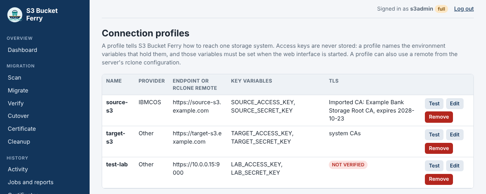

Select **Test** next to a profile to check it. The result opens as a task under
**Activity**:


After saving, S3BucketFerry tells you if a variable you named isn't in the
keys file yet. Add it there before you select **Test**; no restart is needed.

### Edit or fix a profile

Users with full access can change a profile in the web interface. Select
**Edit** next to the profile. The form opens filled in with the saved
settings. Change what you need and select **Save profile**, or **Cancel**.

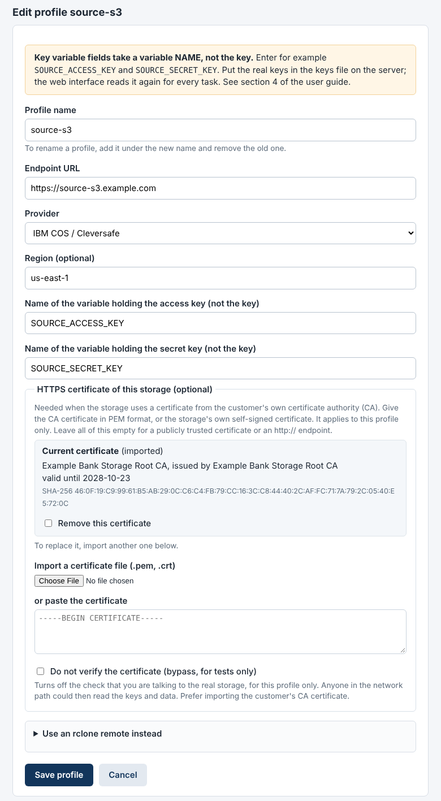

- The profile name can't be changed here. To rename, add the profile under the
  new name and remove the old one.
- If a key variable field held what looks like a real key, the profiles list
  shows **(hidden)** with **Edit this profile: a field holds a key, not a
  variable name**. The key is never shown on screen: the edit form leaves that
  field empty. Type the variable name (for example `SOURCE_ACCESS_KEY`), put
  the real key in the keys file (section 4), and save. The next task uses
  it; no restart is needed.

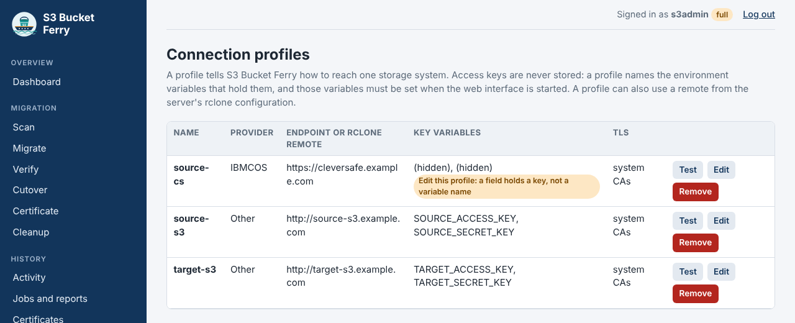

A key that was saved in a profile was stored in plain text in `profiles.json`
and may have been seen on screen. After fixing the profile, change (rotate)
that key pair on the storage system and put the new values in the keys file.

On the command line, change a profile by running `profile add` again with the
same `--name` and all the settings: the new settings replace the old ones.

### HTTPS certificates of the storage systems

Storage systems inside a company usually have an HTTPS certificate issued by
the company's own **certificate authority (CA)**, not by a public one. Your
machine doesn't know that CA, so connections fail with
`x509: certificate signed by unknown authority` until you give the profile the
CA certificate. Do this for each profile that needs it: the source and target
can each have a different customer CA, and a profile without one keeps
trusting the usual public CAs.

**Get the certificate.** Ask the storage administrators for:

- the **CA certificate** (the root, plus any intermediate CA) in **PEM**
  format: a text file starting with `-----BEGIN CERTIFICATE-----`. If the
  storage uses a self-signed certificate instead, its own certificate works
  too;
- its **SHA-256 fingerprint**, so you can check you have the right file. The
  web interface and the command line show the fingerprint after the import.

Never accept a private key: S3BucketFerry refuses a file that contains one. A
`.cer` or `.der` file in binary (DER) format converts with
`openssl x509 -inform der -in ca.cer -out ca.pem`.

**Import it in the web interface.** In the profile form (add, or **Edit**),
under **HTTPS certificate of this storage**, choose the file or paste its
text, and select **Save profile**. The page confirms the import with the
certificate's name and expiry date. The profiles list shows **Imported CA**
with the name and expiry date in the **TLS** column, and **Edit** shows the
details, the fingerprint and **Remove this certificate**:


**Import it on the command line:**

```bash
s3bucketferry profile add --name source-s3 --endpoint https://s3.source.example.com:9021 \
  --access-key-env SOURCE_ACCESS_KEY --secret-key-env SOURCE_SECRET_KEY \
  --ca-cert-import ~/customer-storage-ca.pem
```

```text
certificate : Example Bank Storage Root CA (issued by Example Bank Storage Root CA)
  valid until: 2028-10-23
  SHA-256    : 46:0F:19:C9:99:61:B5:AB:29:0C:C6:C4:FB:79:CC:16:3C:C8:44:40:2C:AF:FC:71:7A:79:2C:05:40:E5:72:0C
imported the certificate to /home/ferry/.config/s3bucketferry/certs/source-s3.pem
saved profile "source-s3"
```

An imported certificate is kept in the state folder (`certs/<profile>.pem`),
so the original file can be moved or deleted. To refer to a file that stays
where it is instead (for example one your administrators keep up to date in
`/etc/pki`), use `--ca-cert FILE`, or the web form's "use a certificate file
already on the server". Either way, the file is checked when you save.

**Check it.** Select **Test** (or `s3bucketferry profile test --name
source-s3`). The first line says how the certificate is checked, for example
`TLS: verified with the profile's certificate "Example Bank Storage Root CA"
(SHA-256 46:0F:...)`. Each migration certificate also records this for the
source and the target.

**Expiry.** The profiles list marks an expired certificate, and the edit form
warns 30 days before. When the customer renews its CA, import the new
certificate; when only the storage's own certificate is renewed by the same
CA, nothing changes here.

**The bypass: "Do not verify the certificate".** Tick it (or use
`--insecure-tls`) to skip the check for this profile's endpoint. Use it only
for tests: without the check, a machine in the network path could pretend to
be the storage and read the keys and the data. The bypass applies to that
profile only; the other endpoint is still checked. The profiles list shows
**NOT VERIFIED**, and a migration certificate made with it says so in its
limitations.

**What is checked for each profile:**

| Profile setting | The endpoint's certificate is checked against |
|---|---|
| No certificate (default) | The public CAs this machine trusts |
| Imported certificate, or a certificate file | That certificate only |
| Do not verify the certificate | Nothing (not checked) |
| `http://` endpoint | No HTTPS, nothing to check |

Since 0.4.0, these settings apply to each profile's own endpoint. Before, a
certificate given for one profile replaced the trusted CAs for both ends of a
migration, and the bypass on one profile turned off checks for both.

### Use an existing rclone remote (advanced)

rclone keeps its own settings file, normally `~/.config/rclone/rclone.conf`,
in which each named entry is a **remote**: an endpoint, a provider type, keys
and any other rclone options. Instead of filling in the endpoint and key
fields, a profile can simply name such a remote. S3BucketFerry then passes
the name to rclone, and rclone reads everything else from its settings file.
Scans, migrations, verification, cutover and certificates work as usual.

Use it when:

- a working rclone remote for that storage already exists;
- you need an rclone option the profile form doesn't offer, such as
  `force_path_style`, `v2_auth`, server-side encryption or `upload_cutoff`
  (see [rclone's S3 page](https://rclone.org/s3/));
- the storage isn't S3: any rclone backend works, for example a local folder.

For ordinary S3 storage, the normal profile fields are simpler and keep the
keys out of files you have to protect yourself.

**1. Create the remote as the user that runs S3BucketFerry.** rclone looks in
the settings file of the user running it: for the web interface, that is the
service user (`ferry` in this guide), not you or root. With the rclone
bundled in the package, either follow the questions:

```bash
sudo -u ferry /opt/s3bucketferry/rclone config
```

or create it in one command:

```bash
sudo -u ferry /opt/s3bucketferry/rclone config create cleversafe s3 \
  provider IBMCOS endpoint https://s3.source.example.com \
  access_key_id <access key> secret_access_key <secret key> \
  ca_cert /etc/pki/tls/certs/storage-ca.pem
```

`ca_cert` is only needed for a certificate from the customer's own CA; give
the full path of a PEM file the service user can read.

**2. Point a profile at it.** In the profile form, open **Use an rclone remote
instead**, type the remote name (`cleversafe`), and leave the endpoint and
key variable fields empty. On the command line:

```bash
s3bucketferry profile add --name source-s3 --rclone-remote cleversafe
```

**3. Test it** with **Test**, or `s3bucketferry profile test --name source-s3`.
The profiles list shows the profile as `(rclone)`, with **as set in the rclone
remote** in the **TLS** column.

**Keep the keys safe.** In a remote, the keys are stored in `rclone.conf`, in
plain text unless you encrypt the file. This is rclone's file, not
S3BucketFerry's, so protect it yourself:

```bash
sudo -u ferry chmod 600 /home/ferry/.config/rclone/rclone.conf
sudo -u ferry /opt/s3bucketferry/rclone config encryption set   # asks for a password
```

After encrypting it, rclone needs the password every time it runs. Put it in
the keys file (section 4), which the web interface reads for every task:

```text
RCLONE_CONFIG_PASS=<the password you chose>
```

On the command line, load the keys file in your session as usual. To use a
settings file in another place, add `RCLONE_CONFIG=<full path>` to the keys
file the same way.

**What doesn't apply to an rclone remote profile:** the key variable fields,
the keys-file reload for the remote's own keys (they live in `rclone.conf`;
an edit there is used from the next task), and certificate import (set
`ca_cert` in the remote instead). "Do not verify the certificate" still works
for the profile, but setting `no_check_certificate = true` in the remote
does the same.

### Add the profiles on the command line

```bash
s3bucketferry profile add --name source-s3 \
  --endpoint http://source-s3.example.com --region us-east-1 \
  --access-key-env SOURCE_ACCESS_KEY --secret-key-env SOURCE_SECRET_KEY

s3bucketferry profile add --name target-s3 \
  --endpoint http://target-s3.example.com --region us-east-1 \
  --access-key-env TARGET_ACCESS_KEY --secret-key-env TARGET_SECRET_KEY
```

Use your own endpoints. Production storage usually uses `https://`; the test
servers in this guide use plain `http://`.

```text
saved profile "source-s3"
keys are read at run time from SOURCE_ACCESS_KEY and SOURCE_SECRET_KEY; nothing secret was stored
```

Other examples:

```bash
# HTTPS endpoint with a certificate from the customer's own CA: import it
s3bucketferry profile add --name source-s3 --endpoint https://s3.source.example.com:9021 \
  --access-key-env SOURCE_ACCESS_KEY --secret-key-env SOURCE_SECRET_KEY \
  --ca-cert-import ~/customer-storage-ca.pem

# the same, referring to a CA file kept on this machine by your administrators
s3bucketferry profile add --name source-s3 --endpoint https://s3.source.example.com:9021 \
  --access-key-env SOURCE_ACCESS_KEY --secret-key-env SOURCE_SECRET_KEY \
  --ca-cert /etc/pki/tls/certs/storage-ca.pem

# a test system: don't verify its certificate (this profile only)
s3bucketferry profile add --name test-lab --endpoint https://10.0.0.15:9000 \
  --access-key-env LAB_ACCESS_KEY --secret-key-env LAB_SECRET_KEY --insecure-tls

# a specific provider type
s3bucketferry profile add --name target-s3 --provider Ceph --endpoint https://rgw.example.com \
  --access-key-env TARGET_ACCESS_KEY --secret-key-env TARGET_SECRET_KEY
```

List and test the profiles:

```text
$ s3bucketferry profile list
NAME       PROVIDER  ENDPOINT / REMOTE             KEY VARIABLES                         TLS
source-s3  Other     http://source-s3.example.com  SOURCE_ACCESS_KEY, SOURCE_SECRET_KEY  none (plain HTTP)
target-s3  Other     http://target-s3.example.com  TARGET_ACCESS_KEY, TARGET_SECRET_KEY  none (plain HTTP)

$ s3bucketferry profile test --name source-s3
TLS: none (plain HTTP)
OK: connected to "source-s3", 2 bucket(s) visible

$ s3bucketferry profile test --name target-s3 --bucket photos
TLS: none (plain HTTP)
OK: bucket "photos" is reachable with profile "target-s3" (4 top-level prefix(es))

$ s3bucketferry profile buckets --name source-s3
archive
photos
```

`--bucket` tests access to one bucket instead of listing them all, which is
useful when the key may only see its own bucket. `profile buckets` lists the
buckets the profile's key can see, one per line (`--json` for scripts); the
web interface uses it for the bucket lists in its forms. A key that may not
list buckets shows none, though it can still reach a bucket you name. `profile remove --name NAME`
deletes a profile.

### Locations

Wherever S3BucketFerry asks for a source or target, you give a **location**:
a profile plus a bucket, and optionally a prefix (folder) inside the bucket.

| Location | Means |
|---|---|
| `source-s3:photos` | the whole `photos` bucket on the source |
| `source-s3:photos/2026` | only objects under `2026/` in that bucket |
| `target-s3:photos-archive` | the `photos-archive` bucket on the target |

In the web interface you choose the profile from a list and type the bucket
(and prefix) next to it.

## 6. Start the web interface

The web interface runs on the S3BucketFerry machine. Start it in a session
where the key variables are loaded.

### Secure by default (HTTPS)

When the web interface listens on a network address, it serves **HTTPS**, so
passwords and pages are encrypted on the network. You don't need to buy or
create a certificate: the first time it starts, each install creates its own:

- a small **certificate authority** (CA) for this machine (`ca.crt`), valid
  10 years;
- a **server certificate** signed by that CA (`server.crt`), valid 397 days,
  covering this machine's host name, its IP addresses and `localhost`.

Both use **ECDSA P-384** keys (384-bit elliptic curve, about as strong as
7680-bit RSA). Connections use **TLS 1.2 or 1.3** only, with forward-secret
AES-GCM or ChaCha20 encryption; older protocols and weak ciphers are refused.
The files are in the `tls` folder of the state folder, and the private keys
can be read only by the user running the web interface.

The keys are created on your machine and never leave it. No certificate ships
inside the release package: a built-in certificate would share one private
key with every other install, and anyone holding the package could
impersonate or decrypt any server.

When the web interface listens only on `127.0.0.1` (this machine), it uses
plain HTTP, because nothing crosses the network.

| Option | Use it to |
|---|---|
| `--listen 0.0.0.0:8443` | Serve HTTPS to other machines on port 8443, the recommended port (8080 stays for plain HTTP on this machine). |
| `--tls-hosts NAMES` | Add host names or addresses to the certificate, comma separated, for example `ferry.example.com`. |
| `--tls-cert FILE --tls-key FILE` | Use your own certificate (for example from your company's CA) instead of the generated one. |
| `--tls on` | Serve HTTPS on `127.0.0.1` too. |
| `--tls off` | Serve plain HTTP even on a network address. Not recommended: passwords would cross the network unencrypted. |

### For a quick test

```bash
s3bucketferry ui                              # http://127.0.0.1:8080, this machine only
s3bucketferry ui --listen 0.0.0.0:8443        # https://<machine address>:8443, from other machines
```

On Windows: `.\s3bucketferry.exe ui --listen 0.0.0.0:8443`. Press Ctrl+C to stop
it.

At start, the web interface prints its certificate details (here on a test
machine called `vm`):

```text
created this install's certificate authority (ECDSA P-384)
created a new server certificate
certificate           : /home/ferry/.config/s3bucketferry/tls/server.crt
valid until           : 2027-12-21
host names            : ferry.example.com, localhost, vm
IP addresses          : 127.0.0.1, 192.0.2.2, ::1
SHA-256 fingerprint   : B1:89:C7:0B:A3:E3:98:7C:74:FA:6A:5A:93:00:E8:74:7D:74:5B:DB:CB:28:AC:4C:81:CB:F3:31:8B:8B:85:9D
CA to trust           : /home/ferry/.config/s3bucketferry/tls/ca.crt
CA SHA-256 fingerprint: 59:8D:8A:4C:6D:C2:F2:5A:40:23:CD:E5:15:FB:F0:BE:05:D7:1D:3A:FB:29:AD:14:48:A0:DF:19:43:EA:34:2E
browsers warn about this certificate until they trust the CA above; see the User Guide, section 6
created the initial user "s3admin" with the default password from the user guide; it must be changed at first login
S3BucketFerry 0.3.5 web interface on https://<this machine's address>:8443 (Ctrl+C to stop)
```

### As a service on Linux (recommended)

A service starts at boot and keeps running when you log out. One command sets
it up:

```bash
sudo s3bucketferry service setup
```

It asks four questions, and shows the answer it will use in brackets: press
Enter to accept it.

| Question | Default | Answer |
|---|---|---|
| Run the web interface as which user | The user who ran `sudo` | The account that runs the migrations. Not `root`. |
| How should browsers connect | **1) HTTPS on port 8443** | Choose 2 for plain HTTP on port 8080. Use HTTP only on a network you trust: passwords would cross it unencrypted. |
| Port | 8443 for HTTPS, 8080 for HTTP | Any free port. A port below 1024, such as 443, works too: setup adds the permission the service needs for it. |
| Which certificate should HTTPS use | **1) The certificate this install creates for itself** | Choose 2 to use your own certificate and private key (see [Using your own certificate](#using-your-own-certificate)). |

With the generated certificate, setup also asks for extra host names, for
example the DNS name people will type (`ferry.example.com`). The machine's own
host name and IP addresses are always included. The generated certificate is
in the `tls` folder of the state folder:

| File | What it is |
|---|---|
| `tls/server.crt` | The web interface's certificate |
| `tls/server.key` | Its private key, readable only by the service user |
| `tls/ca.crt` | This install's certificate authority: the file to trust on your computers, to remove the browser warning |

Setup then shows a summary and asks once more. When you confirm, it:

1. creates the state folder and the keys file, and gives them to the service
   user (it fixes a `~/.config` folder created by `sudo` that belongs to root);
2. keeps a copy of the existing service file, named
   `s3bucketferry-ui.service.bak-<date>-<time>`, and writes the new one to
   `/etc/systemd/system/s3bucketferry-ui.service`;
3. stops the service and checks that no other program is using the port;
4. starts the service, waits until it answers, and confirms it presents the
   certificate you chose;
5. prints the addresses to open, and the certificate's details;
6. offers to open the port in the firewall (ufw or firewalld), if one is on.

Here it moves a 0.3.4 service from port 8080 to HTTPS on 8443, with an extra
host name. The answers are after each `:`; Enter accepts the default:

```text
$ sudo s3bucketferry service setup
S3BucketFerry 0.3.5: web interface service setup
service file: /etc/systemd/system/s3bucketferry-ui.service (exists; a backup is kept before it is replaced)
now: HTTPS on port 8080, running as ferry

Run the web interface as which user (the one who runs migrations) [ferry]:
How should browsers connect to the web interface?
  1) HTTPS on port 8443 (recommended: passwords and pages are encrypted)
  2) HTTP on port 8080 (plain, not encrypted)
Choose 1-2 [1]:
Port [8443]:
Which certificate should HTTPS use?
  1) The certificate this install creates for itself (default)
       certificate: /home/ferry/.config/s3bucketferry/tls/server.crt
       private key: /home/ferry/.config/s3bucketferry/tls/server.key
       CA to trust: /home/ferry/.config/s3bucketferry/tls/ca.crt
  2) My own certificate and private key (PEM files, for example from your company's CA)
Choose 1-2 [1]:
Extra host names for the certificate, comma separated (for example ferry.example.com), or none [none]: ferry.example.com

The service will be:
  runs as       ferry
  state folder  /home/ferry/.config/s3bucketferry
  keys file     /home/ferry/.config/s3bf-keys.env
  connection    HTTPS on 0.0.0.0:8443
  certificate   generated: /home/ferry/.config/s3bucketferry/tls/server.crt
Write the service and restart it? (Y/n):
created the keys file /home/ferry/.config/s3bf-keys.env (mode 600); put the access keys in it (User Guide, section 4)
gave ferry ownership of 66 file(s) and folder(s) in /home/ferry/.config
backed up the old service file to /etc/systemd/system/s3bucketferry-ui.service.bak-20261119-114132
wrote /etc/systemd/system/s3bucketferry-ui.service
waiting for the web interface to answer on port 8443 ...
the web interface is running (https://127.0.0.1:8443/login answers with the expected certificate)

Open it in a browser at:
  https://192.0.2.2:8443/login
  https://ferry.example.com:8443/login

certificate           : /home/ferry/.config/s3bucketferry/tls/server.crt
valid until           : 2027-12-21
host names            : ferry.example.com, localhost, vm
IP addresses          : 127.0.0.1, 192.0.2.2, ::1
SHA-256 fingerprint   : AC:4F:7C:F7:45:25:03:15:FA:CC:D5:EE:B2:09:12:27:37:59:06:31:0B:99:AE:1E:36:AF:62:71:0A:52:D5:B9
CA to trust           : /home/ferry/.config/s3bucketferry/tls/ca.crt
CA SHA-256 fingerprint: 3A:F5:E0:FE:66:E3:E4:6B:C5:55:57:EF:1A:8C:C2:75:AE:A9:E9:B2:30:DD:58:28:32:E2:86:00:B8:95:6D:D9
browsers warn about this certificate until they trust the CA above (User Guide, section 6)

the old address (https, port 8080) no longer answers; tell your users the new one
```

Then open the address it printed, for example
**https://\<machine address\>:8443/login**, and continue with
[the browser warning](#the-browser-warning-and-how-to-remove-it).

Afterwards:

- Put the access keys in the keys file it named (section 4). The web
  interface reads that file for every task, so no restart is needed.
- Add `export S3BF_HOME=$HOME/.config/s3bucketferry` to `~/.bashrc`, so the
  command line uses the same profiles and job history as the service.
- To see the settings at any time: `s3bucketferry service show`.
- To change them (HTTP or HTTPS, the port, the certificate, the user), run
  `sudo s3bucketferry service setup` again. It starts from the current
  settings, so you only change what you need.

```text
$ s3bucketferry service show
service file: /etc/systemd/system/s3bucketferry-ui.service
state       : active
runs as     : ferry
state folder: /home/ferry/.config/s3bucketferry
connection  : HTTPS on port 8443
certificate : generated, /home/ferry/.config/s3bucketferry/tls/server.crt (CA to trust: /home/ferry/.config/s3bucketferry/tls/ca.crt)
address     : https://192.0.2.2:8443/login
address     : https://ferry.example.com:8443/login
```

#### Without questions

In a script, or with `--yes`, setup asks nothing. It uses the options you
give, then the current settings, then the defaults (HTTPS on 8443 with the
generated certificate).

| Command | Sets up |
|---|---|
| `sudo s3bucketferry service setup --yes --user ferry` | HTTPS on 8443, generated certificate |
| `sudo s3bucketferry service setup --yes --tls-hosts ferry.example.com` | The same, with an extra host name in the certificate |
| `sudo s3bucketferry service setup --yes --protocol http` | Plain HTTP on 8080 |
| `sudo s3bucketferry service setup --yes --cert /etc/pki/ferry.crt --key /etc/pki/ferry.key` | HTTPS on 8443 with your own certificate |
| `sudo s3bucketferry service setup --yes --certificate generated` | Back to the generated certificate |
| `sudo s3bucketferry service setup --yes --port 443` | HTTPS on the standard port 443 |

Other options: `--address` (listen on one address only, default `0.0.0.0`:
all of them), `--firewall ask|yes|no` (default `ask`) and `--service NAME` (the
service name, default `s3bucketferry-ui`). `s3bucketferry service setup -h`
lists them all.

### Setting up the service by hand

`service setup` writes the file below for you. To write it yourself instead,
run these as the user who will own the migrations, not as root.

1. Make sure your config folder belongs to you:

   ```bash
   mkdir -p ~/.config/s3bucketferry
   touch ~/.config/s3bf-keys.env && chmod 600 ~/.config/s3bf-keys.env
   sudo chown -R $USER:$USER ~/.config
   ```

2. Check the port is free. If anything is printed, stop that program first; a
   copy of `s3bucketferry ui` started by hand is the usual cause:

   ```bash
   sudo ss -ltnp | grep ':8443'
   ```

3. Create the service. The file is filled in with your user name and home
   folder. Add your server's DNS name to `--tls-hosts` if people will use one.
   For plain HTTP, use `--listen 0.0.0.0:8080 --tls off` instead.

   ```bash
   sudo tee /etc/systemd/system/s3bucketferry-ui.service >/dev/null <<EOF
   [Unit]
   Description=S3BucketFerry web UI
   After=network-online.target
   Wants=network-online.target

   [Service]
   User=$USER
   Environment=S3BF_HOME=$HOME/.config/s3bucketferry
   EnvironmentFile=-$HOME/.config/s3bf-keys.env
   ExecStart=/opt/s3bucketferry/s3bucketferry ui --listen 0.0.0.0:8443 --tls on --tls-hosts ferry.example.com
   Restart=on-failure

   [Install]
   WantedBy=multi-user.target
   EOF
   ```

4. Start it and check it:

   ```bash
   sudo systemctl daemon-reload
   sudo systemctl enable --now s3bucketferry-ui
   sudo systemctl status s3bucketferry-ui --no-pager                    # active (running)
   curl -sI --cacert ~/.config/s3bucketferry/tls/ca.crt https://localhost:8443/login | head -1   # HTTP/1.1 200 OK
   ```

5. If the firewall is on: `sudo ufw allow 8443/tcp` (Ubuntu) or
   `sudo firewall-cmd --add-port=8443/tcp --permanent && sudo firewall-cmd --reload`
   (Red Hat family).

6. Add `export S3BF_HOME=$HOME/.config/s3bucketferry` to `~/.bashrc`.

The web interface reads the keys file again for every task it starts, so a
changed key needs no restart. It finds the file through the service's
`S3BF_KEYS_FILE` setting (written by `service setup` since 0.3.10), the
service's `EnvironmentFile=` line, or `~/.config/s3bf-keys.env`.

To use the standard HTTPS port 443 instead (so the address needs no port),
use `--listen 0.0.0.0:443` and add the line
`AmbientCapabilities=CAP_NET_BIND_SERVICE` under `[Service]`: Linux reserves
ports below 1024 for root, and this line allows the service's user to use
them.

### The browser warning, and how to remove it

Browsers don't know your machine's own CA, so the first visit shows a warning
such as "Your connection is not private". The connection is still encrypted.
You have two choices:

- **Check and continue:** in the browser, view the certificate and compare its
  SHA-256 fingerprint with the one the web interface printed (or
  `s3bucketferry tls show`). If they match, select **Advanced > Proceed**.
- **Trust the CA once** on each computer that uses the web interface: then
  there's no warning, now or after the server certificate is renewed.

Copy `ca.crt` from the server to your computer first, for example from
PowerShell:

```powershell
scp s3admin@192.168.84.13:.config/s3bucketferry/tls/ca.crt .
```

Then add it to the computer's trusted certificate authorities:

| Computer | How |
|---|---|
| Windows (Chrome, Edge) | PowerShell: `Import-Certificate -FilePath ca.crt -CertStoreLocation Cert:\CurrentUser\Root` and confirm. Or double-click `ca.crt` > **Install Certificate** > **Current User** > **Place all certificates in the following store** > **Trusted Root Certification Authorities**. |
| macOS (Safari, Chrome) | `sudo security add-trusted-cert -d -r trustRoot -k /Library/Keychains/System.keychain ca.crt` |
| Ubuntu / Debian | `sudo cp ca.crt /usr/local/share/ca-certificates/s3bucketferry.crt && sudo update-ca-certificates` |
| Red Hat family | `sudo cp ca.crt /etc/pki/ca-trust/source/anchors/s3bucketferry.crt && sudo update-ca-trust` |
| Firefox (any system) | **Settings > Privacy & Security > Certificates > View Certificates > Authorities > Import**, then tick **Trust this CA to identify websites**. |

Restart the browser afterwards. Before trusting it, check that the CA
fingerprint your computer shows matches `CA SHA-256 fingerprint` from
`s3bucketferry tls show`. Trust only a `ca.crt` you copied from your own
server.

### Certificate maintenance

Nothing is needed day to day:

- At every start, the web interface renews the server certificate if it
  expires within 30 days, or if the machine's host name or IP addresses have
  changed. The CA stays the same, so trusted computers keep working.
- `s3bucketferry tls show` prints the certificate's names, expiry and
  fingerprints.
- `s3bucketferry tls renew --hosts ferry.example.com` creates a new server
  certificate now (restart the web interface afterwards).
- To start over with a new CA, stop the web interface and delete the `tls`
  folder in the state folder. Computers that trusted the old CA must trust the
  new one.

### Using your own certificate

If your organisation can issue certificates, use one instead: browsers then
trust it without any extra step, and S3BucketFerry also tells browsers to use
HTTPS only for this server (HSTS).

You need two PEM files: the certificate (it can include the intermediate
certificates after the server certificate) and its private key. The
certificate should name the address people will use, such as
`ferry.example.com`.

For the service, run `sudo s3bucketferry service setup`, choose **2) My own
certificate and private key**, and give the two file names:

```text
Which certificate should HTTPS use?
  1) The certificate this install creates for itself (default)
       ...
  2) My own certificate and private key (PEM files, for example from your company's CA)
Choose 1-2 [1]: 2
Certificate file (PEM, may include the chain): /etc/pki/ferry.crt
Private key file (PEM): /etc/pki/ferry.key
  certificate for: ferry.example.com
  issued by      : Example Corp Issuing CA
  valid until    : 2027-06-07
```

Setup checks that the key belongs to the certificate and that the certificate
hasn't expired, and warns if it expires within 30 days or doesn't name this
machine. It then copies both files to the state folder's `tls` folder as
`own-server.crt` and `own-server.key`, readable only by the service user, so
the originals can stay where they are, owned by root. Without questions:
`sudo s3bucketferry service setup --yes --cert /etc/pki/ferry.crt --key /etc/pki/ferry.key`.

When your certificate is renewed, run the same command with the new files.
To go back to the generated certificate:
`sudo s3bucketferry service setup --yes --certificate generated`.

Without the service, give the files to the `ui` command; the key file must be
readable by the user running it:

```bash
s3bucketferry ui --listen 0.0.0.0:8443 --tls-cert /etc/s3bucketferry/ferry.crt --tls-key /etc/s3bucketferry/ferry.key
```

## 7. First login and the menus


| | |
|---|---|
| User name | `s3admin` |
| Default password | `FerryS3#2026` |
| Access | full |

This default password is published, so you must choose a new one at first
login. Nothing else is available until you do.


A password must be at least 10 characters and use at least three of:
lower-case letters, upper-case letters, digits and symbols. It can't be the
default password or the user name. After 5 wrong passwords an account is
locked for 15 minutes.

The `s3admin` account belongs to the web interface only. It isn't related to
any Linux or Windows account with the same name.

### The dashboard and menus

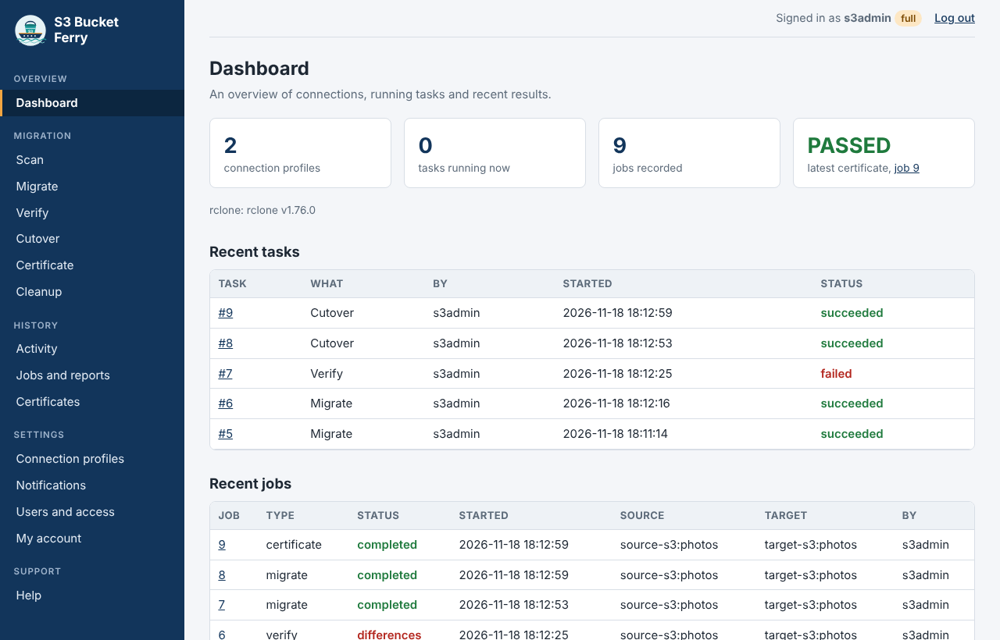

| Menu | Pages |
|---|---|
| **Overview** | **Dashboard**: profile count, running tasks, job count, latest certificate, recent tasks and jobs. |
| **Migration** | **Scan**, **Migrate**, **Verify**, **Cutover**, **Certificate**, **Cleanup**: one page per task. |
| **History** | **Activity**: every task started from the web interface, with its live output. **Jobs and reports**: every job, including those started from the command line. **Certificates**. |
| **Settings** | **Connection profiles**, **Notifications**, **Users and access**, **My account**. |
| **Support** | **Help**: a short reference for every page. **User guide**: this guide, with all its screenshots, in a new browser tab. |

A **task** is something you start from the web interface; a **job** is the
record it leaves in the history, with reports and logs. A cutover is one task
but two jobs: the final sync and the certificate.

### Help and the User guide

**Support > Help** is a short reference: one paragraph per page and task. For
step-by-step instructions, select **Open the User guide** at the top of the
Help page, or **Support > User guide** in the menu.

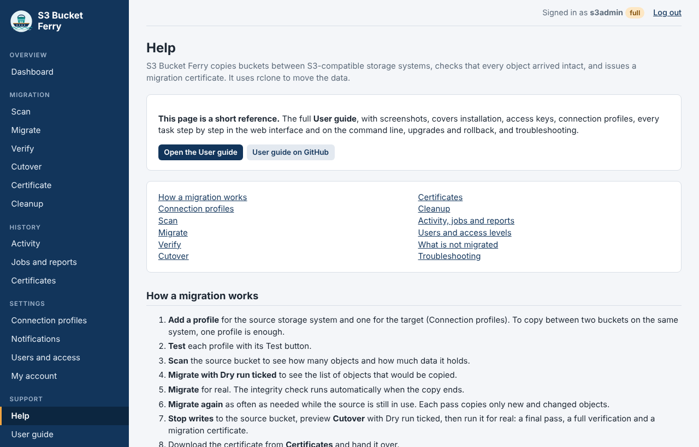

The User guide opens in a new tab. It is the `USER_GUIDE.html` file that every
release package installs next to the program, so it works without internet
access. Any signed-in user can read it. If the file is missing (for example in
a build from source), the page links to the guide on GitHub instead.


## 8. Migrate with the web interface

The migration tasks are numbered steps, shown as tabs at the top of each task
page: **1 Scan, 2 Migrate, 3 Verify, 4 Cutover, 5 Certificate**. The tabs carry
the source and target you have chosen, so the next step opens with the same
buckets. **Cleanup** sits apart on the right: it is not part of the flow and
carries nothing.

When a task finishes, its page (and its job's page) shows **Next step** with
the usual follow-up, keeping the same buckets and settings:

| Finished task | Next step offered |
|---|---|
| Scan | Migrate this bucket (dry run) |
| Migrate, dry run | Run the migration for real |
| Migrate | Verify · Cutover (dry run first) · Migrate again |
| Migrate with failures | Migrate again (copies what is missing) |
| Verify, no differences | Cutover (dry run first) · Issue a certificate |
| Verify with differences | Migrate again (copies what differs) · Verify again |
| Cutover, dry run | Run the cutover for real |
| Cutover / Certificate | Open the certificate |

The step you open is a form, filled in: check it and select its button. A
link never ticks the confirmation for **Mirror deletes**; you tick that
yourself.

While anything runs, every page shows **Running now** under the top bar: each
task with its source and target and its progress (here 17% of objects). Select
it to open the task, where **Stop** is. Jobs started on the command line are
listed too, marked **CLI**, and open their job page. The number beside
**Activity** in the menu counts them.

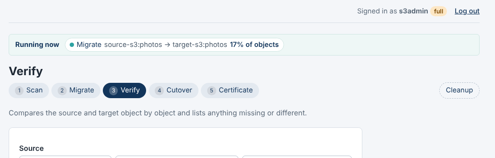

### 8.1 Scan the source

**Migration > Scan**. Choose the source profile. The page then lists the
buckets that profile can see: choose one, or type the bucket name in the box
next to it (add `/prefix` to scan only part of a bucket). Select **Start
scan**.

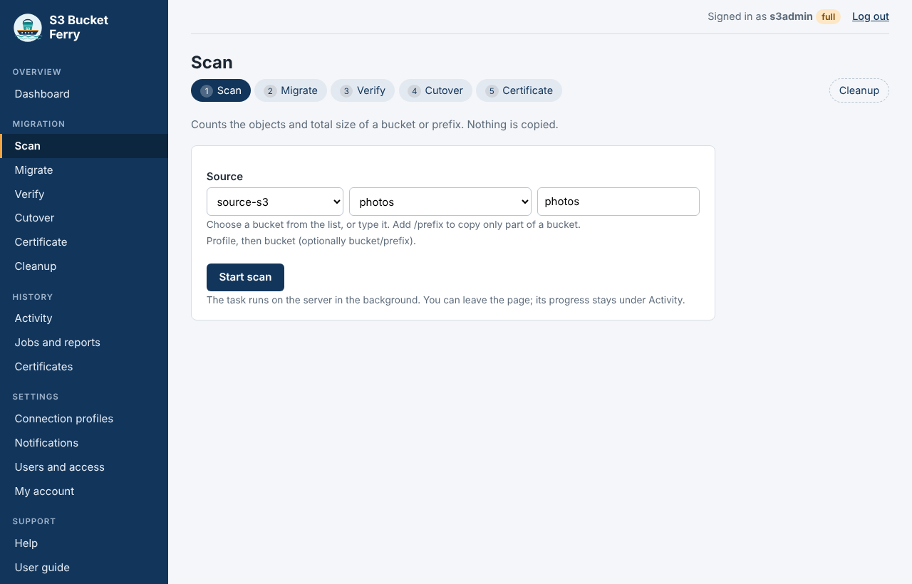

The bucket list appears in every task form (Scan, Migrate, Verify, Cutover,
Certificate, Cleanup), for the source and the target. If it can't be shown,
the page says why under the profile, for example `AccessDenied` when the key
may not list buckets (common for keys limited to one bucket), or a
certificate or region problem with a hint. You can always type the bucket
name instead.

The scan counts the objects and adds up their size. Nothing is copied. When
it has finished, its page shows **Next step: Migrate this bucket**. It opens
**Migrate** with the scanned profile and bucket filled in as the source and
**Dry run** ticked; choose the target and continue with the dry run below.

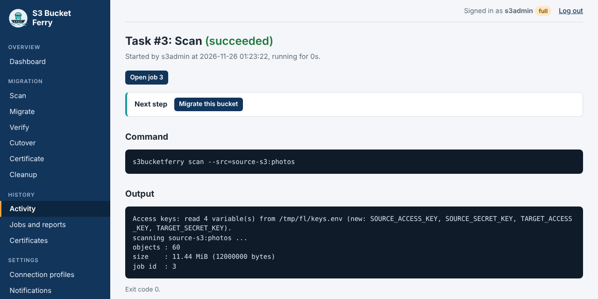

### 8.2 Dry run

**Migration > Migrate** (or **2 Migrate**, or **Migrate this bucket** after the
scan). Fill in the form and leave **Dry run** ticked:


1. Source: profile, then the bucket from the list or typed (optionally
   `bucket/prefix`).
2. Target: profile and bucket, the same way. The target bucket can have a
   different name; to have it created, type a new name.
3. **Dry run**: ticked by default. Nothing is changed while it is ticked.
4. **Preserve object metadata**: keeps each object's content type and custom
   metadata. Recommended.
5. **Advanced options**: speed, bandwidth and other settings (see 8.3).
6. **Start migration**.

The task opens under **Activity**. When it finishes, select **Open job** to see
the plan: every object a real run would copy, with its size.


The plan comes from rclone's own dry run, so it shows exactly what a real run
would do. **Download the full plan (CSV)** gives the complete list for a
spreadsheet.

### 8.3 Advanced options

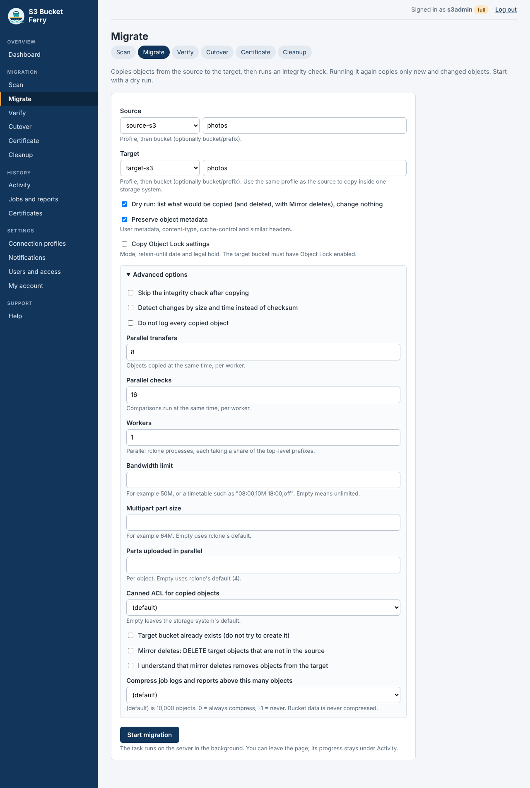

| Option | Use it to |
|---|---|
| Parallel transfers | Copy more objects at once (default 8 per worker). Raise it for many small objects. |
| Parallel checks | Compare more objects at once (default 16). |
| Workers | Run several rclone processes, each taking a share of the bucket's top-level prefixes (folders). Useful for very large buckets. Total parallel copies = workers × transfers. |
| Bandwidth limit | Limit network use, for example `50M` (50 MiB/s), or a timetable such as `08:00,10M 18:00,off` (slow during office hours, unlimited after). |
| Multipart part size, Parts uploaded in parallel | Tune how large objects are uploaded in parts. The defaults suit most cases. |
| Canned ACL for copied objects | Apply one access setting, such as `private`, to every copied object. |
| Target bucket already exists | Don't try to create the target bucket. Tick it when the target key may not create buckets. |
| Skip the integrity check for this pass | Don't compare source and target after this copy. Saves a second full listing of both buckets on very large migrations; Cutover always checks everything. |
| Low-memory listing | List the buckets prefix by prefix instead of all at once: slower, but needs much less memory. For buckets with millions of objects (see [Very large buckets](#very-large-buckets-millions-of-objects)). |
| Mirror deletes | Also **delete** target objects that aren't in the source. A real run needs the confirmation box ticked too. |
| Compress job logs and reports | Change when S3BucketFerry gzips its own log and report files (default: jobs above 10,000 objects). Bucket data is never compressed. |

### 8.4 First copy

After the dry run, select **Next step: Run the migration for real**. It opens
**Migrate** with the same source, target and settings, and **Dry run**
unticked; select **Start migration**. (Or open **Migrate** yourself, fill in
the same source and target, and untick **Dry run**.)

While it runs, the task page shows a live status panel. It refreshes every 3
seconds; you can close the browser and come back, because the task keeps
running on the server.

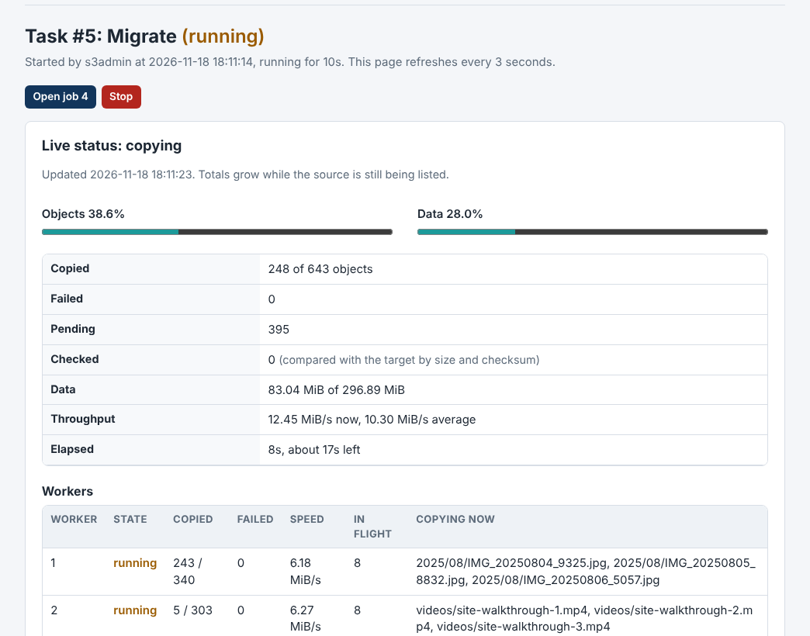

Section 10 explains every number. When the copy finishes, S3BucketFerry
compares source and target automatically. The job page then shows the result:

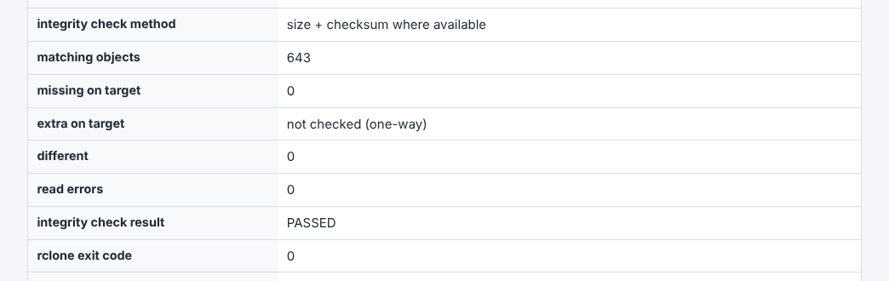

When it has finished, **Next step** offers **Verify**, **Cutover (dry run
first)** and **Migrate again**:

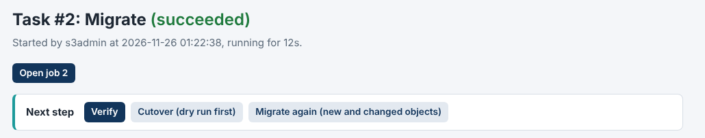

**Stop** on the task page ends a running task. Objects already copied stay on
the target, and **Resume** on the job's page continues where it stopped (see
[Stop and resume](#stop-and-resume) in section 10).

### 8.5 Incremental passes

While users keep working on the source, run **Migrate** again as often as you
like. Each pass compares every object by size and checksum and copies only
what is new or changed:


### 8.6 Verify (optional)

**Migration > Verify** compares both buckets object by object without copying
anything. It reports objects missing on the target, extra on the target, and
different. Here the target holds one object the source doesn't:


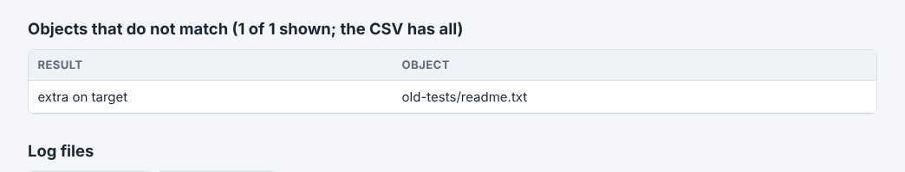

Tick **Full content check** to download and compare both copies byte by byte.
It is slow, but it also covers large objects uploaded in parts, which often
have no comparable checksum.

### 8.7 Preview the cutover

When you are ready to switch over, **stop all writes to the source bucket**.
Then open **Migration > Cutover** (or **Next step: Cutover (dry run first)**
after a migration or a verification). **Dry run** is ticked by default.

Tick **Mirror deletes** under **Advanced options** if the target must end up an
exact copy, including removing objects that were deleted from the source
during the migration. For a dry run you don't need the confirmation box,
because nothing is deleted.

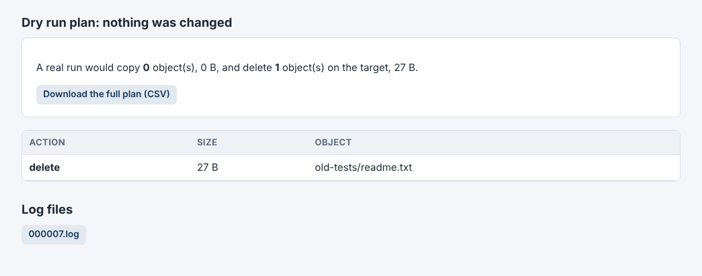

### 8.8 Cutover

Select **Next step: Run the cutover for real** on the dry run's page (or open
**Cutover** again and untick **Dry run**). If you use Mirror deletes, tick **I
understand that mirror deletes removes objects from the target**: a link
never ticks it for you.


Cutover runs a final pass, then a full comparison of both buckets, and issues
the migration certificate:

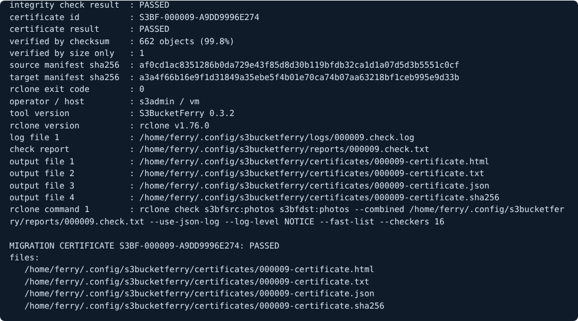

### 8.9 The migration certificate

**History > Certificates** lists every certificate. Open the HTML file to read,
print or send it:


It records both buckets' object counts and sizes, how many objects were
verified by MD5 checksum and how many by size only, any problems, and SHA-256
digests of both bucket listings. Each certificate comes with a `.sha256` file:
`sha256sum -c` on it (Linux) proves the certificate and its evidence files
haven't been changed since. The certificate states what it doesn't cover, such
as older object versions and bucket settings.

### 8.10 Cleanup (optional)

Large objects are uploaded in parts. If an upload is interrupted, its parts can
stay on the bucket and use space without being visible as objects. **Cleanup**
lists these unfinished uploads. Untick **Only list** to remove those older than
the age you give (default 24 hours). Cleanup never touches complete objects.

## 9. Migrate with the command line

The command line does exactly what the web interface does, and its jobs appear
in the web interface too, as long as both use the same state folder. Run
`s3bucketferry <command> -h` for every option of a command.

### 9.1 Scan

```text
$ s3bucketferry scan --src source-s3:invoices
scanning source-s3:invoices ...
objects : 120
size    : 3.46 MiB (3630000 bytes)
job id  : 1
```

### 9.2 Dry run

```bash
s3bucketferry migrate --src source-s3:invoices --dst target-s3:invoices --dry-run
```

The run ends with the plan (the first 100 objects on screen, all of them in a
CSV file):

```text
DRY RUN PLAN - nothing was changed
  would copy   : 120 objects, 3.46 MiB (new or changed on the source)
  would delete : nothing (copy mode never deletes; add --mirror-deletes to preview a sync)

  ACTION  SIZE       OBJECT
  copy    20.02 KiB  2026/q1/INV-q1-0001.pdf
  copy    20.51 KiB  2026/q1/INV-q1-0002.pdf
  ...
full list: /home/ferry/.config/s3bucketferry/reports/000002-dry-run-plan.csv
```

### 9.3 First copy and incremental passes

```bash
s3bucketferry migrate --src source-s3:invoices --dst target-s3:invoices --metadata
```

```text
job 3: source-s3:invoices -> target-s3:invoices
mode   : copy
workers: 1
checks : size + checksum (rclone --checksum)
log    : /home/ferry/.config/s3bucketferry/logs/000003.log
...
objects copied          : 120
bytes copied            : 3.46 MiB (3630000 bytes)
failed objects          : 0
...
integrity check result  : PASSED
...
RESULT: copy complete and integrity check passed
```

`checks : size + checksum` confirms that rclone compares objects by size and
checksum (its `--checksum` mode, the default). After the copy, the integrity
check compares both sides again.

Run the same command again for each incremental pass. Common options:

| Option | Effect |
|---|---|
| `--dry-run` | List what would be copied (and deleted, with `--mirror-deletes`); change nothing |
| `--metadata` | Keep content type and custom metadata |
| `--workers N` | Parallel rclone processes, split by top-level prefix |
| `--transfers N` | Objects copied at once per worker (default 8) |
| `--bwlimit SPEC` | `50M`, or a timetable such as `"08:00,10M 18:00,off"` |
| `--chunk-size SIZE`, `--upload-concurrency N` | Multipart part size and parts in parallel |
| `--acl NAME` | Canned ACL for copied objects, such as `private` |
| `--no-check-bucket` | Don't try to create the target bucket |
| `--mirror-deletes` | Also delete target objects that aren't in the source (rclone sync) |
| `--no-verify` | Skip the comparison after the copy |
| `--no-fast-list` | List prefix by prefix instead of the whole bucket at once: slower, much less memory (section 10, "Very large buckets") |
| `--compress-above N` | Gzip this job's logs and reports above N objects (default 10000; 0 = always, -1 = never) |

`--mirror-deletes` asks for no confirmation on the command line: typing it is
the confirmation. Try it with `--dry-run` first.

If a run stops (Ctrl+C) or fails part-way, `s3bucketferry resume <job id>`
continues it with the same settings; `--full` checks the whole source again.
See section 10, "Stop and resume".

### 9.4 Verify

```text
$ s3bucketferry verify --src source-s3:invoices --dst target-s3:invoices
...
matching objects        : 121
missing on target       : 0
extra on target         : 0
different               : 0
integrity check result  : PASSED
RESULT: source and target match
```

`--download` compares full contents; `--one-way` ignores extra objects on the
target.

### 9.5 Cutover

Stop writes to the source, preview, then run:

```bash
s3bucketferry cutover --src source-s3:invoices --dst target-s3:invoices --metadata --dry-run
s3bucketferry cutover --src source-s3:invoices --dst target-s3:invoices --metadata --out-dir handover
```

```text
MIGRATION CERTIFICATE S3BF-000008-B47040BFD4A5: PASSED
files:
   /home/ferry/.config/s3bucketferry/certificates/000008-certificate.html
   ...
   handover/000008-certificate.html
   handover/000008-certificate.sha256
   handover/000008.source.manifest.tsv
   handover/000008.target.manifest.tsv
```

`--out-dir` copies the certificate and its evidence into a folder you can hand
over. Anyone can check it:

```text
$ cd handover && sha256sum -c *.sha256
000008-certificate.json: OK
000008-certificate.txt: OK
000008-certificate.html: OK
000008.source.manifest.tsv: OK
000008.target.manifest.tsv: OK
000008.check.txt: OK
```

`s3bucketferry certificate --src ... --dst ...` issues a certificate without
copying anything, for example for a migration done another way.

### 9.6 History and reports

```text
$ s3bucketferry jobs
ID  TYPE         STATUS     STARTED           DURATION  SOURCE              TARGET              RESULT
1   scan         completed  2026-11-18 18:17  0s        source-s3:invoices                      120 objects, 3.46 MiB
2   migrate      completed  2026-11-18 18:17  0s        source-s3:invoices  target-s3:invoices  dry run: would copy 120 objects, 3.46 MiB
3   migrate      completed  2026-11-18 18:17  1s        source-s3:invoices  target-s3:invoices  120 copied, 3.46 MiB, 0 failed; check: 120 match, ...
...
8   certificate  completed  2026-11-18 18:17  0s        source-s3:invoices  target-s3:invoices  ... certificate S3BF-000008-B47040BFD4A5 PASSED
```

| Command | Does |
|---|---|
| `job show <id>` | All details of one job |
| `report <id> --format html --out report.html` | A report as text, CSV, HTML or JSON |
| `job bundle <id> --out job.tar.gz` | Everything about a job (reports, logs, plan, failed list, certificate) in one archive |
| `cleanup --dst target-s3:invoices --list` | List unfinished multipart uploads (an empty list means none). Without `--list`, it **removes** those older than `--max-age` (default 24h). |

Exit codes: `0` success, `1` errors or differences, `2` usage error, `130`
interrupted.

## 10. Progress, failures and results

### The live status


| Item | Meaning |
|---|---|
| Objects % / Data % | How far the copy is, by number of objects and by amount of data. |
| Copied | Objects finished, out of the objects found so far. rclone lists the source while it copies, so the total can grow during a run. |
| Failed | Objects that couldn't be copied. |
| Pending | Objects queued or being copied right now. |
| Checked | Objects compared with the target (by size and checksum) and skipped because they already match. |
| Throughput | Speed now and on average. |
| Elapsed | Time so far, and an estimate of the time left. |
| Workers | One row per rclone process: its state, counts, speed, how many objects it has in flight, and which ones. |

On the command line the same information appears as a block that updates in
place:

```text
progress :  38.6% of objects,  28.0% of data   (totals grow while the source is still being listed)
objects  : copied 248 of 643 | failed 0 | pending 395 | checked 0
data     : 83.04 MiB of 296.89 MiB | 12.45 MiB/s now | 10.30 MiB/s average | elapsed 8s | ETA 17s
worker 1 : running  243/340 copied, 0 failed, 6.18 MiB/s, 8 in flight
worker 2 : running  5/303 copied, 0 failed, 6.27 MiB/s, 8 in flight
```

When the output goes to a file or the web interface, a block is printed every
10 seconds instead.

### Failed objects

If an object still fails after rclone's automatic retries, it is listed by
name with its last error. In this example the target storage went offline
during the copy:


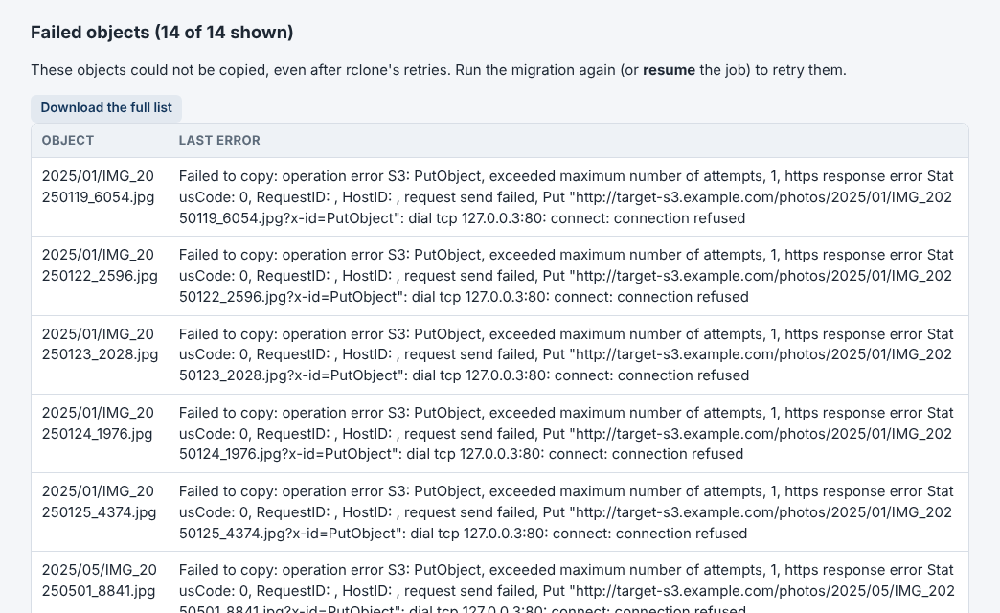

- The run prints the first 20; the job page lists up to 500.
- **Download the full list** gives `logs/<job>.failed-objects.tsv`: one line
  per object, with its error.
- An object that fails once but succeeds on a retry is not listed.
- To retry them, fix the cause (here: bring the target back), then select
  **Resume** on the job's page (or `s3bucketferry resume <job id>`). Objects
  already copied are skipped.

### Stop and resume

A migration can be stopped at any time and continued later, for example for a
maintenance window, a network problem, or to free the network during office
hours.

- **Stop:** select **Stop** on the running task (**Activity**), or press
  Ctrl+C on the command line. rclone finishes nothing new, objects already
  copied stay on the target, and the job is marked **interrupted**.
- **Resume:** open the job (**Jobs**) and select **Resume**, or run
  `s3bucketferry resume <job id>`. It runs the migration again with the same
  settings.
- **Run again:** a job that completed shows **Run again** instead: an
  incremental pass with the same settings.

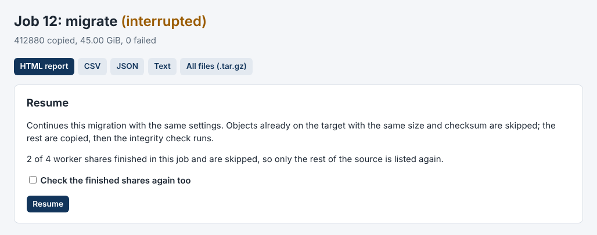

**How a resume knows where to continue.** rclone keeps no checkpoint file.
Instead, a resume lists both buckets and compares every object by size and
checksum, as every pass does, and copies only what is missing or different.
Objects that were copied completely are skipped, not copied again. An object
that was being copied at the moment of the stop is copied again from the
start. After the copy, the integrity check compares everything, as usual.
There is no need for a separate dry run first: comparing is part of the copy.

**Worker shares that finished are skipped.** With several workers, each
worker copies a share of the source's top-level prefixes. When a job stops or
fails part-way, S3BucketFerry records which shares finished, and a resume
doesn't list them again, which saves a lot of time on very large buckets.
Prefixes that appeared in the source since then are copied by an extra share.
To check the finished shares again too, tick **Check the finished shares again
too** (on the command line: `resume <job id> --full`). A resume of a job that
completed always checks everything.

**If the machine restarts or the program is killed** during a migration, the
job is shown as **interrupted** the next time you look at it, and Resume works
the same way. Shares that had finished before the restart are recorded as
they finish, so they are skipped too. (On Windows the job keeps showing
"running"; `s3bucketferry resume <job id>` still continues it.)

There is no pause that freezes a copy in the middle: the storage systems would
close the connections. Stop and Resume are the safe way to do it; the only
work repeated is the objects that were half copied.

### Very large buckets (millions of objects)

The time a pass takes before copying, and the memory it needs, depend on the
number of objects, not their size:

- **Listing:** each list request returns up to 1,000 objects with their size
  and checksum, so the objects aren't downloaded to compare them. A million
  objects take about 1,000 requests per bucket. How long that takes depends on
  the storage systems.
- **Large objects uploaded in parts** don't carry a plain MD5 checksum in the
  listing. rclone reads the checksum it stored for them with one extra request
  per object.
- **Twice per pass:** the copy lists both buckets, and the integrity check
  lists them again. On intermediate passes, **Skip the integrity check for this
  pass** (`--no-verify`) saves the second listing; Cutover always checks
  everything.
- **Memory:** to compare, rclone holds the listing in memory. rclone's own
  documentation puts this at about 0.5 to 1 KB per object, so tens of millions
  of objects in one listing need many gigabytes. To keep it down:
  - use several **workers**: each lists only its share of the prefixes;
  - tick **Low-memory listing** (`--no-fast-list`): the buckets are listed
    prefix by prefix instead of all at once. It is slower, and it helps only
    when the objects are spread over prefixes ("folders").
- **Stop and resume** works the same at any size; with workers, a resume skips
  the shares that finished.

### Job pages and downloads

Every job page has **HTML report**, **CSV**, **JSON**, **Text** and **All files
(.tar.gz)**. The archive holds the reports, logs, check report, dry-run plan,
failed-object list and certificate files, ready to attach to a ticket or keep
as a record.

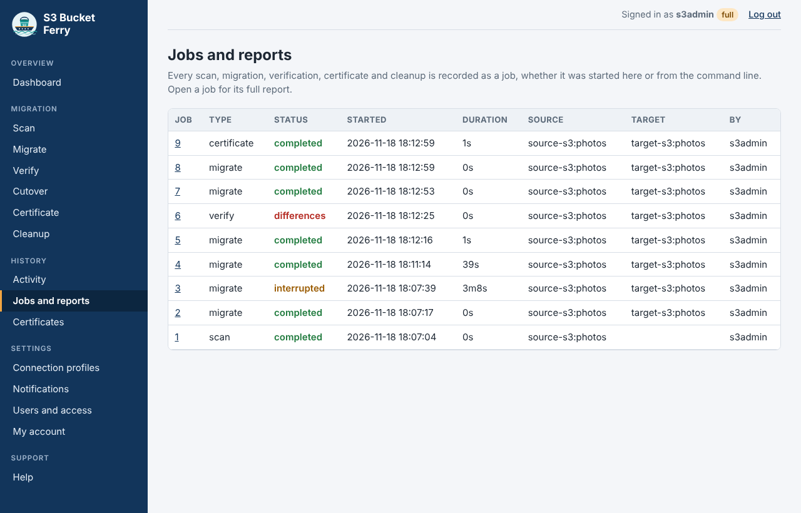

### Large jobs

For jobs above 10,000 objects, S3BucketFerry stores its per-object files (rclone
logs, check reports, dry-run plans, failed-object lists and certificate
manifests) gzip-compressed, with a `.gz` ending. The web pages and reports read
them as usual. On Linux, read them with `zcat` or `zless`. Certificate evidence
is compressed before its checksums are recorded, so `sha256sum -c` still
works.

## 11. Users and access levels

**Settings > Users and access** (full access needed).

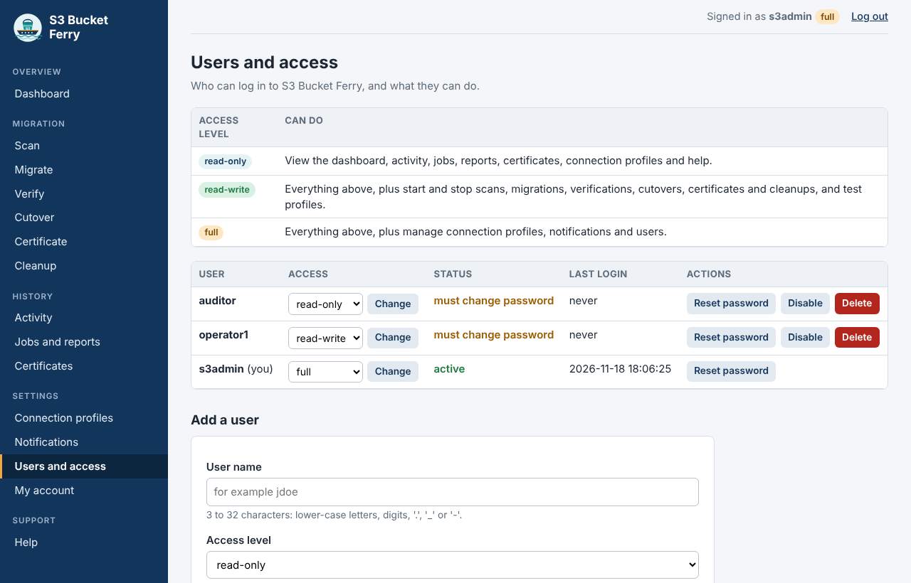

| Access | Can do |
|---|---|
| read-only | View the dashboard, activity, jobs, reports, certificates, connection profiles and help |
| read-write | Also start and stop tasks, and test profiles |
| full | Also add, edit and remove profiles, and manage notifications and users |

- **Add a user:** a name, an access level, and an initial password (leave it
  empty to generate one; it is shown once). The user must choose a new password
  at first login.
- **Change** a user's access with the list next to their name.
- **Reset password** generates a temporary password, shown once.
- **Disable** blocks a user and signs them out; **Enable** restores them.
- **Delete** removes a user.

At least one enabled user always keeps full access, and you can't disable or
delete your own account. Change your own password under **My account**.

If every administrator is locked out, on the server run:

```bash
s3bucketferry user list
s3bucketferry user reset-password --name s3admin   # prints a temporary password
s3bucketferry user unlock --name s3admin           # unlock without changing the password
```

## 12. Notifications

**Settings > Notifications** (full access) sends a message when a migration,
verification, cutover or certificate job ends: to a webhook (for example a chat
channel) and/or by e-mail. Like keys, the webhook URL and the SMTP password are
read from environment variables whose names you enter. **Send a test** checks
the settings.


On the command line:

```bash
s3bucketferry notify set --webhook-url-env S3BF_WEBHOOK_URL
s3bucketferry notify set --smtp-host smtp.example.com --smtp-port 587 \
  --smtp-from ferry@example.com --smtp-to ops@example.com \
  --smtp-user ferry --smtp-pass-env S3BF_SMTP_PASSWORD
s3bucketferry notify test
```

## 13. Check for updates, upgrade and roll back

Upgrades and rollbacks are done on the command line of the S3BucketFerry
machine, not in the web interface. This keeps them in the hands of whoever
administers that machine.

On Linux and macOS, one command handles both S3BucketFerry and its rclone:
`s3bucketferry upgrade`. It runs `upgrade.sh`, which every release package
installs next to the program. It:

1. finds the newest S3BucketFerry release on GitHub and the newest rclone
   release;
2. downloads them and checks each against its published SHA-256 checksum. A
   mismatch stops it, with nothing changed;
3. refuses to start while a migration is running (restarting the web interface
   would stop the tasks it started);
4. keeps a complete copy of the current install in `<install folder>.previous`
   (normally `/opt/s3bucketferry.previous`), for rollback;
5. replaces the program files;
6. restarts every S3BucketFerry service that is running or enabled (normally
   just `s3bucketferry-ui`), and checks each one is running the new version.
   Restarting a service needs root: if you run `s3bucketferry upgrade`
   without `sudo`, it asks for your sudo password **before** changing
   anything, so the web interface never keeps running the old version. If it
   can't get root, it stops with nothing changed. It also warns about a web
   interface started by hand (`s3bucketferry ui` in a terminal), which you
   restart yourself;
7. if that service wasn't set up with `service setup` (section 6), offers to
   run it, so you can choose HTTPS on 8443 or HTTP on 8080 and the
   certificate. With `--yes`, it prints the command instead.

Your profiles, jobs, reports, certificates, web users and keys file are in
the state folder (section 14) and are never touched by an upgrade or a
rollback.

Upgrading from 0.3.9 or earlier? See "Upgrading to 0.3.10" in 13.6 for the
two steps to do once afterwards (and "Upgrading to 0.4.0").

No internet on the S3BucketFerry machine? Copy the new package there and use
the offline upgrade (13.9); it does the same checks, backup and restart.

### 13.1 Check for a new version

```bash
s3bucketferry version                # the version installed
s3bucketferry upgrade --check        # installed and newest versions; changes nothing
```

```text
$ s3bucketferry upgrade --check
install folder: /opt/s3bucketferry
                installed    newest
S3BucketFerry   0.3.2        0.3.3        UPGRADE AVAILABLE
rclone          v1.76.0      v1.76.0      up to date
web UI service: s3bucketferry-ui (running)
```

| Status | Meaning |
|---|---|
| `up to date` | Nothing to do. |
| `UPGRADE AVAILABLE` | A newer version exists; continue with 13.3. |
| `could not reach GitHub` or `could not reach rclone.org or GitHub` | This machine has no internet access, or GitHub's limit of 60 checks an hour was reached. Try again later. |

`--check` needs no `sudo`. The newest S3BucketFerry versions, with what changed,
are also listed on the
[Releases page](https://github.com/debkhadanga2023-lgtm/S3BucketFerry/releases)
and in `CHANGELOG.md` in the install folder. rclone's newest version comes from
`downloads.rclone.org`.

### 13.2 Before you upgrade

- Let running migrations finish: check **Activity** in the web interface, or
  run `pgrep -a rclone`. The upgrade refuses to start while rclone from the
  install folder is running.
- Optional: back up the state folder, or take a snapshot if the machine is a
  virtual machine.

### 13.3 Upgrade

```bash
sudo s3bucketferry upgrade
```

`sudo` is needed because the install folder (`/opt/s3bucketferry`) belongs to
root. Without it, the command stops and shows the exact command to run.

The command asks before changing anything. Answer **Y**, or add `--yes` to skip
the question:

```text
$ sudo s3bucketferry upgrade
S3BucketFerry: 0.3.2 -> 0.3.3 (linux/amd64)
  install folder: /opt/s3bucketferry
Upgrade S3BucketFerry to 0.3.3? [Y/n] y
  downloading s3bucketferry-0.3.3-linux-amd64.tar.gz
  checksum OK: s3bucketferry-0.3.3-linux-amd64.tar.gz
  backup of the current install: /opt/s3bucketferry.previous
  installed: s3bucketferry 0.3.3, rclone v1.76.0
rclone v1.76.0 is up to date
  restarted the s3bucketferry-ui service
  s3bucketferry-ui is running s3bucketferry 0.3.3

install folder: /opt/s3bucketferry
                installed    newest
S3BucketFerry   0.3.3        0.3.3        up to date
rclone          v1.76.0      v1.76.0      up to date
web UI service: s3bucketferry-ui (running)
```

If only rclone has a new version, the same command upgrades just rclone.

### 13.4 Check the result

```bash
s3bucketferry version                                  # the new version
s3bucketferry doctor                                   # versions, rclone found, profiles
sudo systemctl status s3bucketferry-ui --no-pager      # active (running)
```

Then log in to the web interface: your jobs, profiles and users are all there.
A dry run (section 8.2) is a quick way to confirm everything works.

### 13.5 Roll back

If the new version misbehaves, put back the install as it was before the last
upgrade, program and rclone together:

```bash
sudo s3bucketferry upgrade --rollback
```

```text
$ sudo s3bucketferry upgrade --rollback
current : s3bucketferry 0.3.3, rclone v1.76.0
previous: s3bucketferry 0.3.2, rclone v1.76.0
Go back to the previous install? [Y/n] y
  restored. The version you rolled back from is kept in /opt/s3bucketferry.previous (run --rollback again to return to it)
  restarted the s3bucketferry-ui service
  s3bucketferry-ui is running s3bucketferry 0.3.2
```

- The two installs swap places, so running `--rollback` again returns to the
  newer version.
- Rollback needs a previous upgrade made with this command or `upgrade.sh`.
  Otherwise it stops with `no previous install to go back to`.
- Only one previous install is kept. To go back further, install a specific
  version: `sudo s3bucketferry upgrade --version 0.3.2`.
- Rollback only swaps program files. Jobs run with the newer version stay in
  the history.

### 13.6 Other upgrade options

| Command | Does |
|---|---|
| `sudo s3bucketferry upgrade --rclone-only` | Upgrade only rclone. Each release bundles the newest rclone when it is built; rclone may release again in between. |
| `sudo s3bucketferry upgrade --tool-only` | Upgrade only S3BucketFerry, with the rclone in its package. |
| `sudo s3bucketferry upgrade --version 0.3.2` | Install one specific version, newer or older. |
| `--yes` | Don't ask for confirmation. |
| `--force` | Upgrade even though a migration seems to be running. The restart stops tasks the web interface started; resume them afterwards. Use only if you are sure. |
| `--dir FOLDER` | The install folder, if it isn't where `s3bucketferry` is found. |
| `--service NAME` | Restart only this service. Without it, every `s3bucketferry*` service that is running or enabled is restarted. |
| `--no-restart` | Change the files only. Running services keep the old version until you run `sudo systemctl restart s3bucketferry-ui`. |

To change how the web interface service runs (HTTP or HTTPS, the port, the
certificate), use `sudo s3bucketferry service setup` (section 6). The upgrade
leaves those settings as they are.

### Upgrading to 0.4.0

- From **0.3.10**: `sudo s3bucketferry upgrade` is all you need. It restarts
  the web interface by itself.
- From **0.3.9 or earlier**: also do the two steps in "Upgrading to 0.3.10"
  below, once.

Profiles keep their settings. A profile that already names a CA file
(`--ca-cert`) keeps referring to it; to keep a copy with the profile instead,
**Edit** it and import the file. Since 0.4.0, each profile's certificate and
bypass apply to its own endpoint only (section 5, "HTTPS certificates of the
storage systems"). If you used the bypass on one profile to reach the other
end too, give that other profile its own certificate.

### Upgrading to 0.3.10: two steps, once

An upgrade from 0.3.9 or earlier runs the **old** `upgrade.sh`, which doesn't
restart the web interface for you. So this one time:

```bash
sudo s3bucketferry upgrade
sudo systemctl restart s3bucketferry-ui        # 1. needed once, after this upgrade
sudo s3bucketferry service setup               # 2. recommended: records where the keys file is
s3bucketferry version                           # should print s3bucketferry 0.3.10
```

1. **Restart the web interface.** Until you do, it keeps running the old
   version: no keys reload, and the old screens. Check: the first line of the
   next task's output starts with `Access keys: read ...`.
2. **Run `service setup` once (recommended).** It writes the keys file's
   location into the service (`S3BF_KEYS_FILE`), so the web interface always
   finds the file it reads before every task. Press Enter to keep each current
   answer. It restarts the service when it finishes, so it also covers step 1.
   Without this step it still finds the file through the service's
   `EnvironmentFile=` line or at `~/.config/s3bf-keys.env`. If the first line of
   a task says `keys file ... not found`, run this step.

From 0.3.10 on, `upgrade` restarts the web interface by itself (13.3, step 6),
so the first step is no longer needed.

### Upgrading to 0.3.5: choose HTTP or HTTPS for the service

Since 0.3.4, the web interface serves HTTPS whenever it listens on a network
address. A service set up earlier with `--listen 0.0.0.0:8080` therefore answers
on **https**://\<machine address\>:8080, and the old `http://` address shows
`Client sent an HTTP request to an HTTPS server.`

0.3.5 adds `service setup` to fix this in one step. After upgrading, run:

```bash
sudo s3bucketferry upgrade
sudo s3bucketferry service setup
```

Choose **1) HTTPS** to move to port 8443 (recommended), or **2) HTTP** to keep
plain HTTP on port 8080. For HTTPS, choose the generated certificate (press
Enter) or your own. See section 6 for the questions and a sample run.

The upgrade from 0.3.4 runs 0.3.4's `upgrade.sh`, which doesn't know about
`service setup` yet, so run the second command yourself. From 0.3.5 on, the
upgrade offers it when the service wasn't written by it.

### 13.7 Upgrading from 0.3.1

Version 0.3.1 doesn't include the upgrade command yet. Download the script
once and run it; it works the same way:

```bash
cd /tmp
curl -fsSLO https://raw.githubusercontent.com/debkhadanga2023-lgtm/S3BucketFerry/main/scripts/upgrade.sh
bash upgrade.sh --check
sudo bash upgrade.sh
```

From then on use `s3bucketferry upgrade`. A rollback after this upgrade
(`sudo s3bucketferry upgrade --rollback`) returns to 0.3.1.

### 13.8 Builds from source

This is for maintainers who build S3BucketFerry from its source code, which
isn't public. The upgrade command also works for a program you built yourself, as long as
`s3bucketferry` and `rclone` are in `/opt/s3bucketferry` (section 6). It replaces
them with the official release package. To stay on your own builds instead:

```bash
cd ~/S3BucketFerry && git pull
make build && bash scripts/fetch-rclone.sh linux amd64 .
sudo systemctl stop s3bucketferry-ui
sudo cp s3bucketferry rclone scripts/upgrade.sh /opt/s3bucketferry/
sudo systemctl start s3bucketferry-ui
```

### 13.9 Offline upgrade (no internet on the machine)

Copy the new release's files to the S3BucketFerry machine, as for an
[offline installation](#offline-installation-no-internet-on-the-machine): the
package and `SHA256SUMS.txt`, in one folder. Nothing is downloaded during the
upgrade.

#### Linux, offline

```bash
s3bucketferry version                                           # what you have now
sudo s3bucketferry upgrade --package /tmp/s3bucketferry-0.4.2-linux-amd64.tar.gz
```

It works exactly like the online upgrade (13.3): it checks the package against
`SHA256SUMS.txt` next to it, refuses to start while a migration is running,
keeps the current install in `/opt/s3bucketferry.previous`, replaces the files
(including the rclone in the package), and restarts the service. A rollback
works the same way, offline: `sudo s3bucketferry upgrade --rollback`.

```text
$ sudo s3bucketferry upgrade --package /tmp/s3bucketferry-0.0.2-linux-amd64.tar.gz
S3BucketFerry: 0.0.1 -> 0.0.2 (linux/amd64), from /tmp/s3bucketferry-0.0.2-linux-amd64.tar.gz
  install folder: /opt/s3bucketferry
  checksum OK: s3bucketferry-0.0.2-linux-amd64.tar.gz
  backup of the current install: /opt/s3bucketferry.previous
  installed: s3bucketferry 0.0.2, rclone v1.76.0

installed: s3bucketferry 0.0.2, rclone v1.76.0
```

(Sample from the upgrade test, with test version numbers.)

| Option | Use it to |
|---|---|
| `--package FILE` | Install this S3BucketFerry package. It must be for this machine's system and CPU (for example `linux-amd64`). An older version than the installed one is allowed, for a downgrade. |
| `--rclone-zip FILE` | Install a newer rclone between S3BucketFerry releases: `rclone-v<version>-linux-amd64.zip` from the version's folder on [downloads.rclone.org](https://downloads.rclone.org/) or rclone's GitHub releases, with that folder's `SHA256SUMS` copied next to it. |
| `--checksums FILE` | The checksum file, if it isn't in the same folder as the package. |
| `--force` | Reinstall the version that is already installed (and skip the running-migration check). |
| `--yes` | Don't ask for confirmation. |

Both `--package` and `--rclone-zip` can be given in one command. Without the
checksum file the upgrade stops and changes nothing: the check is what proves
the copy is complete and unaltered.

**From 0.3.5 or earlier**, the installed `upgrade.sh` doesn't have
`--package` yet. Use the one inside the new package, once:

```bash
cd /tmp
tar -xzf s3bucketferry-0.4.2-linux-amd64.tar.gz
sudo bash s3bucketferry-0.4.2-linux-amd64/upgrade.sh --dir /opt/s3bucketferry \
     --package /tmp/s3bucketferry-0.4.2-linux-amd64.tar.gz
```

From then on use `sudo s3bucketferry upgrade --package ...`.

To check for a new version, use a computer with internet access: compare
`s3bucketferry version` with the newest release on the
[Releases page](https://github.com/debkhadanga2023-lgtm/S3BucketFerry/releases).
`s3bucketferry upgrade --check` needs internet access.

#### Windows, offline

The same steps as an online Windows upgrade (13.10), with the files copied
instead of downloaded. In PowerShell:

```powershell
cd D:\                                                     # the folder with the copied files
(Get-FileHash .\s3bucketferry-0.4.2-windows-amd64.zip -Algorithm SHA256).Hash.ToLower()
Select-String -Path .\SHA256SUMS.txt -Pattern "windows-amd64.zip"   # must show the same value
```

Stop the web interface (Ctrl+C in its window), then:

```powershell
Remove-Item C:\S3BucketFerry.previous -Recurse -Force -ErrorAction SilentlyContinue
Copy-Item C:\S3BucketFerry C:\S3BucketFerry.previous -Recurse           # your rollback copy
Expand-Archive .\s3bucketferry-0.4.2-windows-amd64.zip -DestinationPath $env:TEMP\s3bf -Force
Copy-Item $env:TEMP\s3bf\s3bucketferry-0.4.2-windows-amd64\* C:\S3BucketFerry -Recurse -Force
C:\S3BucketFerry\s3bucketferry.exe version
```

Start the web interface again. To roll back, stop it and copy the files back:
`Copy-Item C:\S3BucketFerry.previous\* C:\S3BucketFerry -Recurse -Force`.
Settings and history in `%AppData%\s3bucketferry` are kept either way.

### 13.10 Windows

Upgrades aren't automated on Windows, and there is no rollback command.

1. Check your version with `.\s3bucketferry.exe version`, and the newest on the
   [Releases page](https://github.com/debkhadanga2023-lgtm/S3BucketFerry/releases).
2. Stop the web interface (Ctrl+C in its window).
3. Copy the program folder (for example `C:\S3BucketFerry`) to
   `C:\S3BucketFerry.previous`. This copy is your rollback.
4. Download the new `windows-amd64.zip` and extract it over the program folder.
5. Start the web interface again.

To roll back, stop the web interface and copy the files from
`C:\S3BucketFerry.previous` back. Settings and history are in
`%AppData%\s3bucketferry` and are kept either way.

### 13.11 Upgrade problems

| Message | What to do |
|---|---|
| `no write access to /opt/s3bucketferry; run with sudo` | Run the command it shows, with `sudo`: normally `sudo s3bucketferry upgrade`. |
| `sudo: /opt/s3bucketferry/upgrade.sh: command not found` or `Permission denied` | The script has lost its execute permission (for example when copied from a Git checkout). Use `sudo s3bucketferry upgrade`, or `sudo bash /opt/s3bucketferry/upgrade.sh`; both work without it. |
| `a migration is running` | Wait for it to finish (`pgrep -a rclone`). Use `--force` only if you are sure nothing is running. |
| `could not find the newest release on GitHub` | No internet access, or GitHub's hourly limit was reached. Try later, or name the version with `--version`. |
| `checksum mismatch ... nothing was changed` | The download was damaged or altered. Try again later. If it repeats, report it on GitHub; don't install that file by hand. |
| `missing programs: unzip` | `sudo apt install -y unzip` (Ubuntu/Debian) or `sudo dnf install -y unzip` (Red Hat family). Needed for rclone downloads. |
| `no previous install to go back to` | No upgrade has been made with the command yet, so there is nothing to roll back to. Use `--version` to install a specific version. |
| `cannot find upgrade.sh next to s3bucketferry` | The install predates 0.3.2. Use 13.7 once. |
| `no checksum file for ...` | Copy `SHA256SUMS.txt` (for a package) or rclone's `SHA256SUMS` (for an rclone zip) from the same release into the same folder, or name it with `--checksums`. |
| `... is for linux/arm64, but this machine is linux/amd64` | The copied package is for another CPU. Copy the one matching this machine (`uname -m`: `x86_64` is amd64, `aarch64` is arm64). |
| `unknown option --package` | The installed `upgrade.sh` is from 0.3.5 or earlier. Use the `upgrade.sh` inside the new package once (13.9). |
| `could not find the newest release on GitHub` on a machine without internet | `upgrade` and `upgrade --check` need internet access. Use the offline upgrade (13.9). |
| `the upgrade must restart s3bucketferry-ui ... and that needs root` | Run `sudo s3bucketferry upgrade`. Nothing was changed. (It asks for sudo by itself when it can; this appears when there is no terminal to type the password, for example in a script.) |
| `version` shows the new version but the web interface still looks old | The service wasn't restarted, for example after an upgrade with `--no-restart` or by a version before 0.3.10. Run `sudo systemctl restart s3bucketferry-ui`. |
| `a web interface started by hand (process N) still runs the old version` | Stop it (`kill N`) and start it again, or use the service instead (section 6). |
| The web interface doesn't start after an upgrade | `sudo journalctl -u s3bucketferry-ui -n 30`; if the new version is at fault, run `sudo s3bucketferry upgrade --rollback`. |

## 14. Where data is kept

Everything S3BucketFerry records is in its **state folder**:

| System | Default state folder |
|---|---|
| Linux | `~/.config/s3bucketferry` |
| Windows | `%AppData%\s3bucketferry` |
| macOS | `~/Library/Application Support/s3bucketferry` |

Set `S3BF_HOME` to use another folder. The web interface and the command line
share the history only when they use the same folder.

| File or folder | Content |
|---|---|
| `users.json` | Web accounts: names, access levels and salted password hashes (PBKDF2-SHA256), never plain passwords |
| `profiles.json`, `notify.json` | Settings, without keys or passwords |
| `certs/` | HTTPS certificates imported into profiles (`<profile>.pem`); public certificates, no private keys |
| `jobs/` | One record per job, and the live status of running jobs |
| `logs/` | rclone logs and failed-object lists |
| `reports/` | Check reports, dry-run plans and bucket manifests |
| `certificates/` | Certificates (HTML, text, JSON) and their `.sha256` files |
| `ui-runs/`, `ui-runs.json` | Output of tasks started from the web interface |
| `audit.log` | One line per action: logins, failed logins, user and profile changes, tasks started, and every command run |

Back up this folder to keep the history and certificates. Restrict access to
it: it holds the password hashes and the job history.

## 15. What S3BucketFerry changes on your buckets

- **The source bucket is only ever read.** No command writes to it, changes it
  or deletes from it.
- **Scan, dry runs, verify and certificate change nothing** on either bucket.
- **Migrate and cutover** (copy mode, the default) write to the target only:
  - they add objects that aren't on the target yet;
  - they **overwrite** a target object with the same name as a source object
    but a different size or checksum, so the target matches the source;
  - they never delete anything;
  - they create the target bucket if it doesn't exist, unless you tick
    **Target bucket already exists** (`--no-check-bucket`);
  - the objects they write get the metadata, Object Lock and ACL settings you
    chose.
- **Mirror deletes** (`--mirror-deletes`) is the only mode that deletes objects:
  target objects that aren't in the source. Always preview it with a dry run.
- **Cleanup** removes unfinished multipart uploads, never complete objects.
- **Objects are copied byte for byte.** S3BucketFerry compresses only its own
  log and report files, never bucket data.
- With `--no-checksum` (change detection by size and time), rclone may update
  the modification-time metadata of target objects. The default checksum mode
  doesn't.

What isn't migrated: older object versions (only the current version of each
object), per-object ACLs (use a canned ACL instead), and bucket settings such as
versioning, lifecycle rules, bucket policies and Object Lock defaults.

## 16. Troubleshooting

| Problem | Likely cause | What to do |
|---|---|---|
| `environment variables X and Y must both be set` | The variables aren't in the keys file, or (command line) aren't loaded in this session | Add them to the keys file (section 4). The web interface reads it for every task; on the command line, load it again in your session. The first line of the task output names the keys file used. |
| Task output: `keys file ... not found` or `cannot read the keys file` | The keys file named in the service is missing, or the service user can't read it | Create it, or fix its owner: `sudo chown <service user> <file>; sudo chmod 600 <file>`. The task used the keys the web interface started with. |
| `a key variable field holds what looks like a real key` (when saving or testing a profile) | The access key or secret key itself was typed into a key variable field | Type the variable **name**, for example `SOURCE_ACCESS_KEY`, and put the key in the keys file (section 4). For an existing profile, select **Edit** on the profiles page (section 5, "Edit or fix a profile"). |
| The profiles page shows **(hidden)** and **Edit this profile: a field holds a key** | The profile was saved with a key instead of a variable name, usually by a version before 0.3.9 | Select **Edit**, type the variable names, and save. Then rotate that key pair on the storage system: it was stored in plain text. |
| `don't start a key variable name with RCLONE_` | rclone reads `RCLONE_...` variables as its own settings | Rename the variable in the keys file, for example `SOURCE_ACCESS_KEY`, and use that name in the profile. |
| `InvalidAccessKeyId` or `SignatureDoesNotMatch` | Wrong key, or a space or quote pasted with it | Check the values in your keys file. The next task uses the new values; check its first line says the variable "changed". |
| Error mentioning the region, or `AuthorizationHeaderMalformed` | The storage expects a specific region | Set the profile's region to the one your administrators gave you. |
| `AccessDenied` | The key lacks a permission | See the permissions in section 2. For bucket creation, create the target bucket first and tick **Target bucket already exists**. |
| `Could not list the buckets: AccessDenied` under a profile in a task form | The key may not list buckets (normal for a key limited to one bucket) | Type the bucket name; the task can still use the bucket. |
| `Could not list the buckets` with another message | The profile can't connect: the message and its hint name the cause (keys, certificate, region) | Fix the profile, then choose it again; or select **Test** on the profiles page. |
| `didn't find section in config file ("<name>")` | The profile names an rclone remote that doesn't exist in the settings file of the user running the task | Check the name (`sudo -u ferry /opt/s3bucketferry/rclone listremotes`). For the web interface, create the remote as the service user (section 5, "Use an existing rclone remote"). |
| `Enter configuration password` ... `Failed to read line: EOF` | rclone's settings file is encrypted and no password was given | Add `RCLONE_CONFIG_PASS=<password>` to the keys file (section 4). |
| `x509: certificate signed by unknown authority` | The storage's HTTPS certificate comes from the customer's own CA | Import the CA certificate into the profile: **Edit** > **HTTPS certificate of this storage**, or `--ca-cert-import FILE` (section 5, "HTTPS certificates of the storage systems"). The bypass is for tests only. |
| `x509: certificate has expired or is not yet valid` | The storage's certificate expired, or this machine's clock is wrong | Ask the storage administrators to renew it; check the clock (`timedatectl`). |
| `x509: certificate is valid for <name>, not <other>` | The endpoint URL uses a name or IP address the certificate doesn't cover | Use the host name the certificate was issued for in the endpoint URL. |
| `the file contains a private key` when importing | A key file, or a file with both, was given | Give only the certificate. The private key stays on the storage system. |
| `no certificate found: expected a PEM file` when importing | The file is binary (DER) or not a certificate | Convert it: `openssl x509 -inform der -in ca.cer -out ca.pem`. |
| Profiles list: certificate **EXPIRED** | The imported certificate's end date has passed | Import the customer's new CA certificate (**Edit**). |
| `NoSuchBucket` | Bucket name typo, or the endpoint expects bucket names in the host name | Check the name. Keep the provider on **Other**, which uses path-style addressing. |
| `RequestTimeTooSkewed` | This machine's clock is wrong | Fix the time: `timedatectl` (Linux), or **Settings > Time & language** (Windows). |
| Connection refused or timeouts | Wrong endpoint or port, firewall, or the storage is down | Test with `curl -I <endpoint>` from this machine. |
| Many failed objects | Network or storage trouble during the run | Fix the cause, then run the migration again: only missing objects are copied. |
| Certificate FAILED with checksum differences on large objects | The two systems compute checksums differently for objects uploaded in parts | Issue the certificate with **Full content check** (`--download`). |
| Web interface not reachable | It is listening on 127.0.0.1, the port is taken, or the firewall blocks it | Use `--listen 0.0.0.0:8443`; check `sudo ss -ltnp \| grep 8443` and the firewall (section 6). |
| Browser shows `Client sent an HTTP request to an HTTPS server.` | The address starts with `http://` | Use `https://`. |
| Browser warns "Your connection is not private" (`NET::ERR_CERT_AUTHORITY_INVALID`) | The browser doesn't know this machine's CA yet | Compare the fingerprint and continue, or trust `ca.crt` (section 6). |
| `NET::ERR_CERT_COMMON_NAME_INVALID` | You used a name or address the certificate doesn't cover | Add it: `s3bucketferry tls renew --hosts <name>`, or `--tls-hosts` on the service, then restart. |
| `bind: permission denied` on a port below 1024 (such as 443) | Ports below 1024 need permission | Use 8443, or add `AmbientCapabilities=CAP_NET_BIND_SERVICE` to the service (section 6). |
| Service fails at once (`status=1/FAILURE`) | Port in use, or part of `~/.config` belongs to root | Run `sudo s3bucketferry service setup`: it fixes the folder owner and checks the port. Details: `sudo journalctl -u s3bucketferry-ui -n 40`. |
| Still listening on port 8080 after upgrading | The service file still says `--listen 0.0.0.0:8080` | `sudo s3bucketferry service setup` and choose HTTPS on 8443 (section 13, "Upgrading to 0.3.5"). |
| `service setup`: `cannot write /etc/systemd/system ... run with sudo` | It was run without sudo | `sudo s3bucketferry service setup`. |
| `service setup`: `port 8443 is in use by another program` | Usually a copy of `s3bucketferry ui` started by hand | Stop it (`pgrep -af "s3bucketferry ui"`, then `kill <pid>`), then `sudo systemctl restart s3bucketferry-ui`. |
| `service setup`: `private key does not match public key` | The key file belongs to another certificate | Use the key that was created with the certificate. Nothing was changed. |
| `service setup`: `the web interface did not answer` | The service didn't start | `sudo journalctl -u s3bucketferry-ui -n 30 --no-pager`. The previous service file is kept as `.bak-<date>-<time>` in `/etc/systemd/system`. |
| Locked out of the web interface | 5 wrong passwords | Wait 15 minutes, or `s3bucketferry user unlock --name <user>`. |
| A migration was stopped, or the machine restarted during one | The job is marked interrupted | Open the job and select **Resume**, or `s3bucketferry resume <job id>`. Objects already copied are skipped (section 10, "Stop and resume"). |
| rclone is killed or the machine runs out of memory on a huge bucket | The listing of millions of objects doesn't fit in memory | Use several workers and **Low-memory listing** (`--no-fast-list`), then resume (section 10, "Very large buckets"). |
| A pass takes a long time before copying anything | Both buckets are being listed and compared | Normal for millions of objects. Skip the integrity check on intermediate passes; with workers, a resume skips finished shares. |

Logs: each job's rclone logs are in `logs/` in the state folder, and the web
interface service logs with `sudo journalctl -u s3bucketferry-ui`.

To report a problem, open an issue on
[GitHub](https://github.com/debkhadanga2023-lgtm/S3BucketFerry/issues) with the
job bundle (`s3bucketferry job bundle <id>`). Remove anything confidential
first, such as host names or bucket names you don't want to publish.

## 17. Glossary

| Word | Meaning |
|---|---|
| S3 | The storage protocol first used by Amazon S3, now supported by most object storage systems. |
| Object | A file stored in S3, with its data, size, checksum and metadata. |
| Bucket | A top-level container of objects, like a drive or share. |
| Prefix | The "folder" part of an object's name. In `2026/01/IMG_0001.jpg` the prefix is `2026/01/`. |
| Endpoint | The web address of an S3 storage system. |
| Access key, secret key | The user name and password S3 applications use. |
| Region | A location name some storage systems use for buckets, such as `us-east-1`. |
| Source, target | The storage you copy from, and the storage you copy to. |
| Connection profile | S3BucketFerry's saved settings for reaching one storage system. |
| HTTPS certificate | What a storage system shows to prove its identity on an `https://` connection. |
| Certificate authority (CA) | Who issues HTTPS certificates. A company's own CA must be imported into the profile; public CAs are already trusted. |
| PEM | The text format for certificates, starting with `-----BEGIN CERTIFICATE-----`. |
| Fingerprint (SHA-256) | A short value that identifies a certificate; compare it with the one the administrators give you. |
| Location | A profile plus a bucket and optional prefix, such as `source-s3:photos/2026`. |
| Dry run | A run that only reports what would change, and changes nothing. |
| Checksum (MD5) | A fingerprint of an object's contents; equal checksums mean equal contents. |
| Multipart upload | How large objects are uploaded: in parts that the storage joins together. |
| Incremental pass | A run that copies only new and changed objects. |
| Cutover | The final pass, after writes to the source stop, followed by verification and a certificate. |
| Mirror deletes (sync) | Also deleting target objects that aren't in the source, so the target is an exact copy. |
| Canned ACL | A predefined access setting for objects, such as `private`. |
| Object Lock | A storage feature that prevents objects from being changed or deleted until a set date. |
| Worker | One rclone process copying a share of the bucket. |
| Job | The record of one run: settings, results, reports and logs. |
| State folder | Where S3BucketFerry keeps its settings and history. |

---

S3BucketFerry is MIT licensed, Copyright (c) 2026 Deb Khadanga. It uses
[rclone](https://rclone.org), MIT licensed by its authors.
