# S3BucketFerry User Guide

Version 0.3.3

S3BucketFerry ("S3 Bucket Ferry") copies buckets from one S3-compatible storage
system to another, checks every object, and issues a migration certificate at
the end. It works with any storage that speaks the S3 protocol, such as
on-premises object storage, public clouds and software S3 gateways. You can use
it from a web browser or from the command line, and both do exactly the same
thing.

This guide takes you from installation to a finished, certified migration. It
assumes no previous experience with S3. If a word is new to you, look it up in
the [glossary](#17-glossary) at the end.

## Contents

1. [How a migration works](#1-how-a-migration-works)
2. [What you need](#2-what-you-need)
3. [Install](#3-install)
4. [Store the access keys](#4-store-the-access-keys)
5. [Connection profiles: source and target](#5-connection-profiles-source-and-target)
6. [Start the web interface](#6-start-the-web-interface)
7. [First login and the menus](#7-first-login-and-the-menus)
8. [Migrate with the web interface](#8-migrate-with-the-web-interface)
9. [Migrate with the command line](#9-migrate-with-the-command-line)
10. [Progress, failures and results](#10-progress-failures-and-results)
11. [Users and access levels](#11-users-and-access-levels)
12. [Notifications](#12-notifications)
13. [Check for updates, upgrade and roll back](#13-check-for-updates-upgrade-and-roll-back)
14. [Where data is kept](#14-where-data-is-kept)
15. [What S3BucketFerry changes on your buckets](#15-what-s3bucketferry-changes-on-your-buckets)
16. [Troubleshooting](#16-troubleshooting)
17. [Glossary](#17-glossary)

The screenshots and sample output in this guide come from real migrations
between two test S3 servers, `source-s3.example.com` and `target-s3.example.com`,
mostly made with version 0.3.2. The screens are the same in 0.3.3, except for
the new **User guide** link. Your names, numbers and dates will differ.

This guide is also built into the web interface: **Support > User guide**.

---

## 1. How a migration works

S3 storage keeps data as **objects** (files) inside **buckets** (top-level
containers). A migration copies the objects of a bucket on one storage system
(the **source**) to a bucket on another (the **target**).

S3BucketFerry runs on a machine that can reach both systems. Data flows from
the source, through that machine, to the target. The source is only ever read.

A migration has five steps:

| Step | What you do | What happens |
|---|---|---|
| 1. Assess | **Scan** the source, then **Migrate** with **Dry run** ticked | You see how many objects there are, and the list of objects that would be copied. Nothing is changed. |
| 2. First copy | **Migrate** | Every object is copied, then both sides are compared. |
| 3. Keep up to date | **Migrate** again, as often as needed | Only new and changed objects are copied. Users can keep working on the source meanwhile. |
| 4. Preview the cutover | Stop writes to the source, then **Cutover** with **Dry run** ticked | You see what the final pass would change. |
| 5. Cutover | **Cutover** | A final pass, a full comparison of both buckets, and a migration certificate. Point your users and applications at the target. |

Behind the scenes S3BucketFerry uses [rclone](https://rclone.org), a widely
used open-source data mover. rclone comes in the same package; you don't need
to install it separately.

## 2. What you need

### A machine to run it on

- Linux (x86-64 or ARM64), Windows (x86-64) or macOS (Intel or Apple silicon).
- Network access to both S3 endpoints. If the source and target are on
  different networks, this machine must be able to reach both.
- Enough network bandwidth: every byte passes through this machine. Disk space
  is needed only for logs and reports, not for the data being copied.

For a small test, a virtual machine with 2 CPUs and 4 GB of memory is plenty.

### Details from your storage administrators

Ask for these for **both** the source and the target:

| Detail | Example | Notes |
|---|---|---|
| Endpoint URL | `https://s3.storage.example.com` | The address S3 applications use. Include `https://` or `http://`, and the port if it isn't the default, for example `https://s3.example.com:9021`. |
| Access key | `AKIA...` or `0555b35654ad1656d804` | Like a user name for S3. |
| Secret key | (a long random string) | Like a password. Keep it secret. |
| Region | `us-east-1` | Many on-premises systems accept any value or none. Ask if unsure. |
| Bucket names | `photos` | The source bucket to copy, and the target bucket to copy into. |
| CA certificate | `storage-ca.pem` | Only if the endpoint uses an HTTPS certificate from a private certificate authority. |

The keys need these permissions:

- **Source:** list the bucket and read its objects. The connection test also
  lists your buckets, if allowed.
- **Target:** list the bucket, write objects and read them back. Also create
  the bucket if it doesn't exist yet (otherwise create it first and tick
  **Target bucket already exists**). Delete objects only if you'll use
  **Mirror deletes**.

Create and configure the target bucket in advance if it needs settings such as
versioning, lifecycle rules, bucket policies or Object Lock. S3BucketFerry
copies objects, not bucket settings.

## 3. Install

Each release package contains `s3bucketferry`, a matching `rclone`, the
licenses, this guide and (on Linux and macOS) `upgrade.sh`. The guide comes
twice: `USER_GUIDE.html`, one page with all screenshots that opens in any
browser without internet access, and `USER_GUIDE.md`. Packages are on the
[Releases page](https://github.com/debkhadanga2023-lgtm/S3BucketFerry/releases):

| System | Package |
|---|---|
| Linux, Intel/AMD | `s3bucketferry-0.3.3-linux-amd64.tar.gz` |
| Linux, ARM | `s3bucketferry-0.3.3-linux-arm64.tar.gz` |
| Windows | `s3bucketferry-0.3.3-windows-amd64.zip` |
| macOS, Intel | `s3bucketferry-0.3.3-macos-amd64.tar.gz` |
| macOS, Apple silicon | `s3bucketferry-0.3.3-macos-arm64.tar.gz` |

Every release also has `SHA256SUMS.txt`, which lets you confirm the download
is complete and unaltered.

### Linux

```bash
VER=0.3.3
BASE=https://github.com/debkhadanga2023-lgtm/S3BucketFerry/releases/download/v$VER
cd /tmp
curl -fLO $BASE/s3bucketferry-$VER-linux-amd64.tar.gz
curl -fLO $BASE/SHA256SUMS.txt
sha256sum -c --ignore-missing SHA256SUMS.txt      # must print: OK

sudo mkdir -p /opt/s3bucketferry
sudo tar -xzf s3bucketferry-$VER-linux-amd64.tar.gz -C /opt/s3bucketferry --strip-components=1
sudo ln -sf /opt/s3bucketferry/s3bucketferry /usr/local/bin/s3bucketferry
s3bucketferry version
```

On an ARM machine, use `linux-arm64` instead of `linux-amd64`.

### Windows

1. Download `s3bucketferry-0.3.3-windows-amd64.zip`.
2. Right-click the file, select **Extract All**, and extract to a folder such as
   `C:\S3BucketFerry`.
3. Open **PowerShell** in that folder and run `.\s3bucketferry.exe version`.

### macOS

Same as Linux, with the `macos-amd64` or `macos-arm64` package. If macOS
refuses to open the program because it is from an unidentified developer, run
`xattr -d com.apple.quarantine s3bucketferry rclone` in the unpacked folder.

### Check the installation

```text
$ s3bucketferry doctor
S3BucketFerry : 0.3.2
state folder  : /home/ferry/.config/s3bucketferry
rclone path   : /opt/s3bucketferry/rclone
rclone        : rclone v1.76.0
profiles      : 0
notifications : none
updates       : s3bucketferry upgrade --check
```

`doctor` must find the rclone next to the program. (The sample output above
is from version 0.3.2.) The **state folder** is
where S3BucketFerry keeps its settings and history (section 14).

### From source (developers)

Building needs Go 1.24 or later:

```bash
git clone https://github.com/debkhadanga2023-lgtm/S3BucketFerry.git
cd S3BucketFerry
make build                                   # builds ./s3bucketferry
bash scripts/fetch-rclone.sh linux amd64 .   # downloads the newest rclone next to it
```

## 4. Store the access keys

S3BucketFerry never saves access keys in its own files. Instead you put each
key in an **environment variable**, a named value that programs started from
the same session can read. A connection profile (section 5) stores only the
*name* of the variable.

This guide uses four names. You can choose your own:

| Variable | Holds |
|---|---|
| `SOURCE_ACCESS_KEY` | the source access key |
| `SOURCE_SECRET_KEY` | the source secret key |
| `TARGET_ACCESS_KEY` | the target access key |
| `TARGET_SECRET_KEY` | the target secret key |

Don't start a variable name with `RCLONE_`. rclone reads every `RCLONE_...`
variable as one of its own settings.

### Linux and macOS

Keep the keys in a file only you can read, and load it in every session:

```bash
mkdir -p ~/.config
cat > ~/.config/s3bf-keys.env <<'EOF'
SOURCE_ACCESS_KEY=paste-the-source-access-key-here
SOURCE_SECRET_KEY=paste-the-source-secret-key-here
TARGET_ACCESS_KEY=paste-the-target-access-key-here
TARGET_SECRET_KEY=paste-the-target-secret-key-here
EOF
chmod 600 ~/.config/s3bf-keys.env
nano ~/.config/s3bf-keys.env                  # put in the real values; no spaces or quotes

echo 'set -a; . ~/.config/s3bf-keys.env; set +a' >> ~/.bashrc
set -a; . ~/.config/s3bf-keys.env; set +a     # load them now
```

### Windows PowerShell

For the current window only:

```powershell
$env:SOURCE_ACCESS_KEY = "paste-the-source-access-key-here"
$env:SOURCE_SECRET_KEY = "paste-the-source-secret-key-here"
$env:TARGET_ACCESS_KEY = "paste-the-target-access-key-here"
$env:TARGET_SECRET_KEY = "paste-the-target-secret-key-here"
```

To keep them for future windows, use `setx SOURCE_ACCESS_KEY "value"` (and so
on), then open a new PowerShell window. `setx` stores the values in your
Windows user profile.

Whenever you change a key, restart the web interface so it reads the new
value.

## 5. Connection profiles: source and target

A **connection profile** tells S3BucketFerry how to reach one storage system:
its endpoint, provider type, region, and which variables hold its keys. You
need two: one for the source and one for the target. Give them names you will
recognise. This guide uses `source-s3` and `target-s3`.

To copy between two buckets on the **same** storage system, one profile is
enough: use it as both source and target.

### What to enter

| Field (web) | Option (command line) | What to enter |
|---|---|---|
| Profile name | `--name` | Letters, digits, `-` and `_`. Saving a name that exists replaces that profile. |
| Endpoint URL | `--endpoint` | The S3 address, for example `https://s3.storage.example.com`. |
| Provider | `--provider` | The type of storage. **Other S3-compatible** (`Other`) works for most systems; it's the default. Choose **Amazon S3** (`AWS`), **IBM COS / Cleversafe** (`IBMCOS`), **Ceph** or **MinIO** when that is what you have. The command line accepts any provider name that rclone supports; see [rclone's S3 page](https://rclone.org/s3/). |
| Region | `--region` | The region your administrators gave you. Leave it empty if none. |
| Access key variable | `--access-key-env` | The **name** of the variable, for example `SOURCE_ACCESS_KEY`. Not the key itself. |
| Secret key variable | `--secret-key-env` | The **name** of the variable, for example `SOURCE_SECRET_KEY`. |
| CA certificate file | `--ca-cert` | Only for HTTPS endpoints whose certificate comes from a private certificate authority: the path of its PEM file on this machine. |
| Do not verify the TLS certificate | `--insecure-tls` | For tests only. It turns off a security check. |
| rclone remote | `--rclone-remote` | Advanced: use a remote that already exists in your rclone configuration instead of the fields above. |

A common mistake is typing the key itself into the key variable field. The
error then shows your key as a variable name ("environment variables
AKIA... must both be set"). Remove the profile and add it again with the
variable names.

### Add the profiles in the web interface

Open **Connection profiles** (full access needed), fill in **Add or update a
profile**, and select **Save profile**. Then do the same for the target.

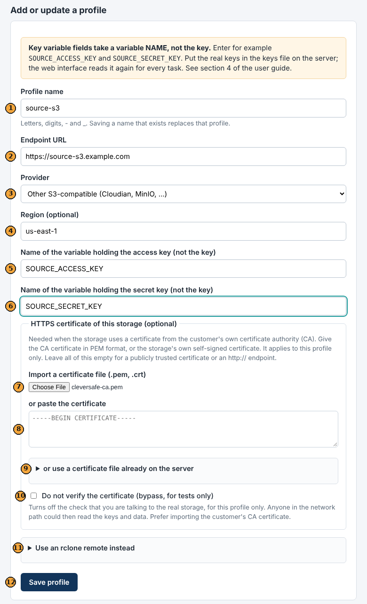

1. Profile name, for example `source-s3`.
2. Endpoint URL.
3. Provider: keep **Other S3-compatible** unless your storage is listed.
4. Region, if your storage needs one.
5. Name of the variable holding the access key.
6. Name of the variable holding the secret key.
7. CA certificate file, only for a private certificate authority.
8. An existing rclone remote, as an alternative to fields 2 to 7.
9. **Save profile**.

Both profiles then appear at the top of the page:


Select **Test** next to a profile to check it. The result opens as a task under
**Activity**:

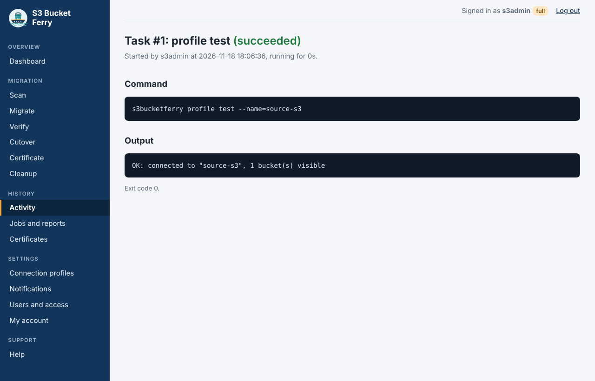

### Add the profiles on the command line

```bash
s3bucketferry profile add --name source-s3 \
  --endpoint http://source-s3.example.com --region us-east-1 \
  --access-key-env SOURCE_ACCESS_KEY --secret-key-env SOURCE_SECRET_KEY

s3bucketferry profile add --name target-s3 \
  --endpoint http://target-s3.example.com --region us-east-1 \
  --access-key-env TARGET_ACCESS_KEY --secret-key-env TARGET_SECRET_KEY
```

Use your own endpoints. Production storage usually uses `https://`; the test
servers in this guide use plain `http://`.

```text
saved profile "source-s3"
keys are read at run time from SOURCE_ACCESS_KEY and SOURCE_SECRET_KEY; nothing secret was stored
```

Other examples:

```bash
# HTTPS endpoint with a certificate from a private certificate authority
s3bucketferry profile add --name source-s3 --endpoint https://s3.source.example.com:9021 \
  --access-key-env SOURCE_ACCESS_KEY --secret-key-env SOURCE_SECRET_KEY \
  --ca-cert /etc/pki/tls/certs/storage-ca.pem

# a specific provider type
s3bucketferry profile add --name target-s3 --provider Ceph --endpoint https://rgw.example.com \
  --access-key-env TARGET_ACCESS_KEY --secret-key-env TARGET_SECRET_KEY
```

List and test the profiles:

```text
$ s3bucketferry profile list
NAME       PROVIDER  ENDPOINT / REMOTE             KEY VARIABLES                         TLS
source-s3  Other     http://source-s3.example.com  SOURCE_ACCESS_KEY, SOURCE_SECRET_KEY  system CAs
target-s3  Other     http://target-s3.example.com  TARGET_ACCESS_KEY, TARGET_SECRET_KEY  system CAs

$ s3bucketferry profile test --name source-s3
OK: connected to "source-s3", 2 bucket(s) visible

$ s3bucketferry profile test --name target-s3 --bucket photos
OK: bucket "photos" is reachable with profile "target-s3" (4 top-level prefix(es))
```

`--bucket` tests access to one bucket instead of listing them all, which is
useful when the key may only see its own bucket. `profile remove --name NAME`
deletes a profile.

### Locations

Wherever S3BucketFerry asks for a source or target, you give a **location**:
a profile plus a bucket, and optionally a prefix (folder) inside the bucket.

| Location | Means |
|---|---|
| `source-s3:photos` | the whole `photos` bucket on the source |
| `source-s3:photos/2026` | only objects under `2026/` in that bucket |
| `target-s3:photos-archive` | the `photos-archive` bucket on the target |

In the web interface you choose the profile from a list and type the bucket
(and prefix) next to it.

## 6. Start the web interface

The web interface runs on the S3BucketFerry machine. Start it in a session
where the key variables are loaded.

### For a quick test

```bash
s3bucketferry ui                          # http://127.0.0.1:8080, this machine only
s3bucketferry ui --listen 0.0.0.0:8080    # reachable from other machines
```

On Windows: `.\s3bucketferry.exe ui`. Press Ctrl+C to stop it.

Without `--tls-cert` and `--tls-key` the interface uses plain HTTP, and it
prints a warning when listening on a network address. On a shared network,
serve HTTPS:

```bash
s3bucketferry ui --listen 0.0.0.0:8443 --tls-cert server.crt --tls-key server.key
```

### As a service on Linux (recommended)

A service starts at boot and keeps running when you log out. Run these as the
user who will own the migrations, not as root.

1. Make sure your config folder belongs to you:

   ```bash
   mkdir -p ~/.config/s3bucketferry
   touch ~/.config/s3bf-keys.env && chmod 600 ~/.config/s3bf-keys.env
   sudo chown -R $USER:$USER ~/.config
   ```

2. Check the port is free. If anything is printed, stop that program first; a
   copy of `s3bucketferry ui` started by hand is the usual cause.

   ```bash
   sudo ss -ltnp | grep ':8080'
   ```

3. Create the service. The file is filled in with your user name and home folder:

   ```bash
   sudo tee /etc/systemd/system/s3bucketferry-ui.service >/dev/null <<EOF
   [Unit]
   Description=S3BucketFerry web UI
   After=network-online.target
   Wants=network-online.target

   [Service]
   User=$USER
   Environment=S3BF_HOME=$HOME/.config/s3bucketferry
   EnvironmentFile=-$HOME/.config/s3bf-keys.env
   ExecStart=/opt/s3bucketferry/s3bucketferry ui --listen 0.0.0.0:8080
   Restart=on-failure

   [Install]
   WantedBy=multi-user.target
   EOF
   ```

4. Start it and check it:

   ```bash
   sudo systemctl daemon-reload
   sudo systemctl enable --now s3bucketferry-ui
   sudo systemctl status s3bucketferry-ui --no-pager    # active (running)
   curl -sI http://127.0.0.1:8080/login | head -1       # HTTP/1.1 200 OK
   ```

5. If the firewall is on: `sudo ufw allow 8080/tcp` (Ubuntu) or
   `sudo firewall-cmd --add-port=8080/tcp --permanent && sudo firewall-cmd --reload`
   (Red Hat family).

6. Add `export S3BF_HOME=$HOME/.config/s3bucketferry` to `~/.bashrc`, so the
   command line uses the same profiles and job history as the service.

After changing the keys file, run `sudo systemctl restart s3bucketferry-ui`.

Then open `http://<machine address>:8080/login` in a browser.

## 7. First login and the menus

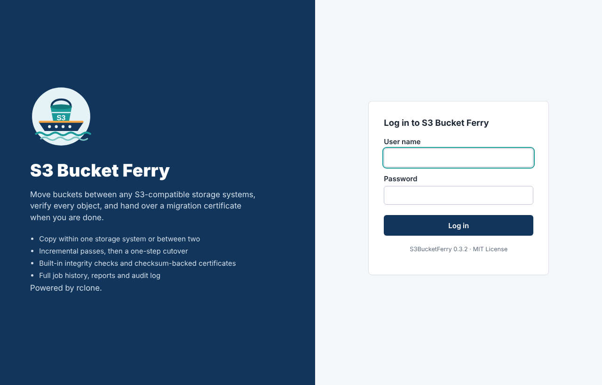

| | |
|---|---|
| User name | `s3admin` |
| Default password | `FerryS3#2026` |
| Access | full |

This default password is published, so you must choose a new one at first
login. Nothing else is available until you do.

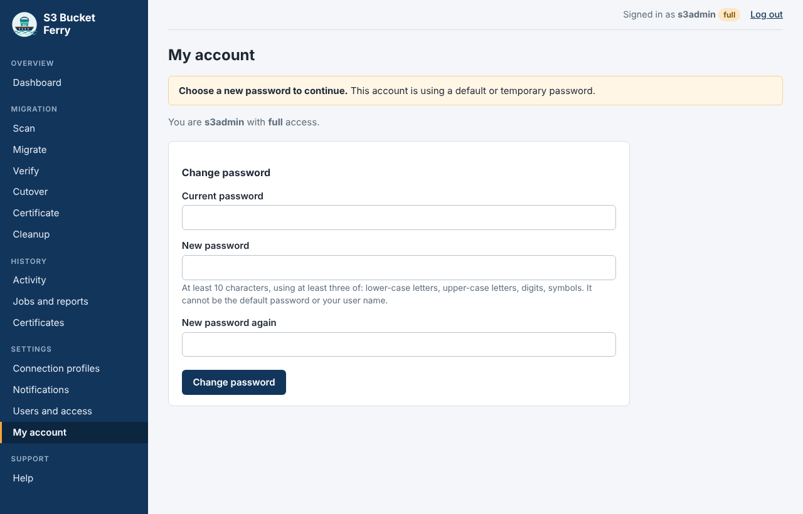

A password must be at least 10 characters and use at least three of:
lower-case letters, upper-case letters, digits and symbols. It can't be the
default password or the user name. After 5 wrong passwords an account is
locked for 15 minutes.

The `s3admin` account belongs to the web interface only. It isn't related to
any Linux or Windows account with the same name.

### The dashboard and menus


| Menu | Pages |
|---|---|
| **Overview** | **Dashboard**: profile count, running tasks, job count, latest certificate, recent tasks and jobs. |
| **Migration** | **Scan**, **Migrate**, **Verify**, **Cutover**, **Certificate**, **Cleanup**: one page per task. |
| **History** | **Activity**: every task started from the web interface, with its live output. **Jobs and reports**: every job, including those started from the command line. **Certificates**. |
| **Settings** | **Connection profiles**, **Notifications**, **Users and access**, **My account**. |
| **Support** | **Help**: a short reference for every page. **User guide**: this guide, with all its screenshots, in a new browser tab. |

A **task** is something you start from the web interface; a **job** is the
record it leaves in the history, with reports and logs. A cutover is one task
but two jobs: the final sync and the certificate.

### Help and the User guide

**Support > Help** is a short reference: one paragraph per page and task. For
step-by-step instructions, select **Open the User guide** at the top of the
Help page, or **Support > User guide** in the menu.


The User guide opens in a new tab. It is the `USER_GUIDE.html` file that every
release package installs next to the program, so it works without internet
access. Any signed-in user can read it. If the file is missing (for example in
a build from source), the page links to the guide on GitHub instead.

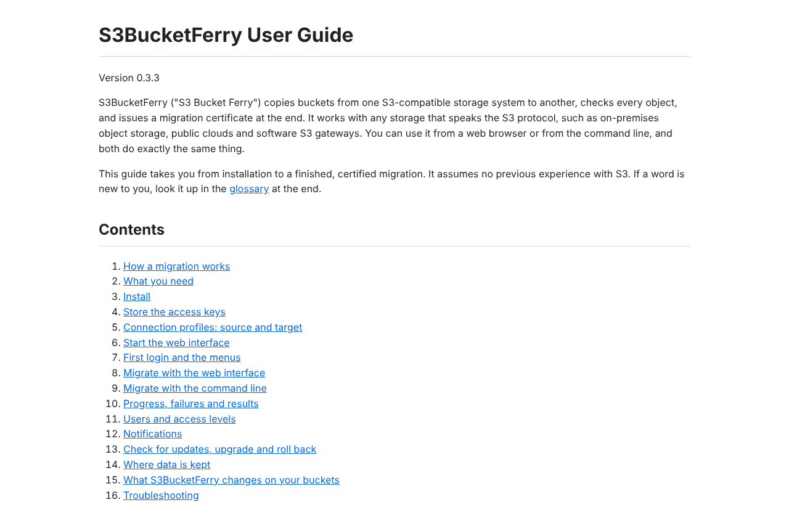

## 8. Migrate with the web interface

### 8.1 Scan the source

**Migration > Scan**. Choose the source profile, type the bucket, and select
**Start scan**.


The scan counts the objects and adds up their size. Nothing is copied.

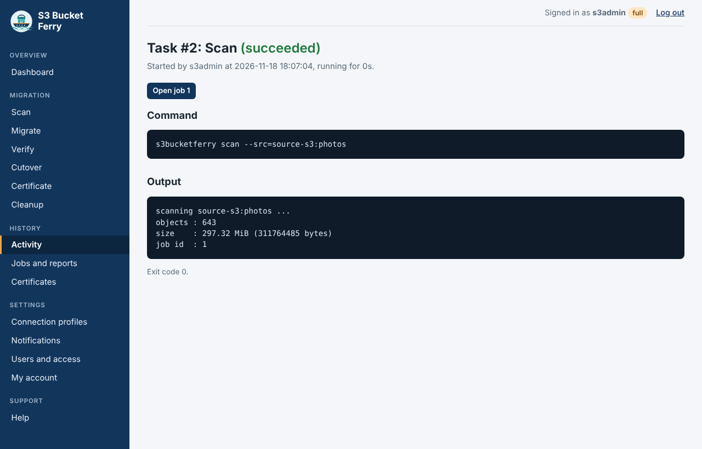

### 8.2 Dry run

**Migration > Migrate**. Fill in the form and leave **Dry run** ticked:

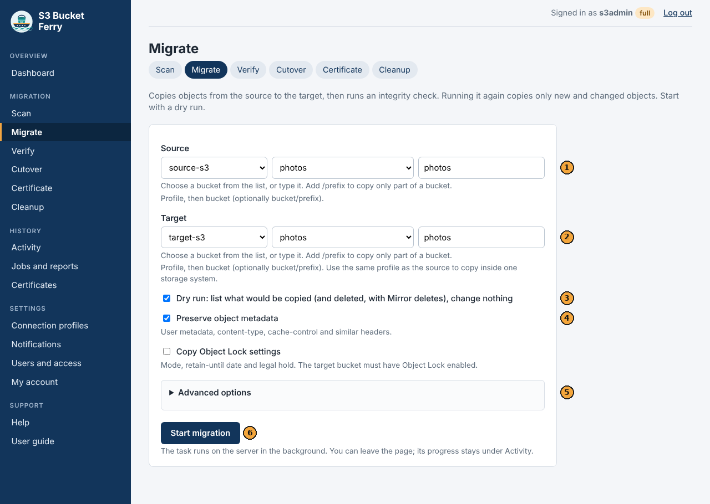

1. Source: profile and bucket (optionally `bucket/prefix`).
2. Target: profile and bucket. The target bucket can have a different name.
3. **Dry run**: ticked by default. Nothing is changed while it is ticked.
4. **Preserve object metadata**: keeps each object's content type and custom
   metadata. Recommended.
5. **Advanced options**: speed, bandwidth and other settings (see 8.3).
6. **Start migration**.

The task opens under **Activity**. When it finishes, select **Open job** to see
the plan: every object a real run would copy, with its size.

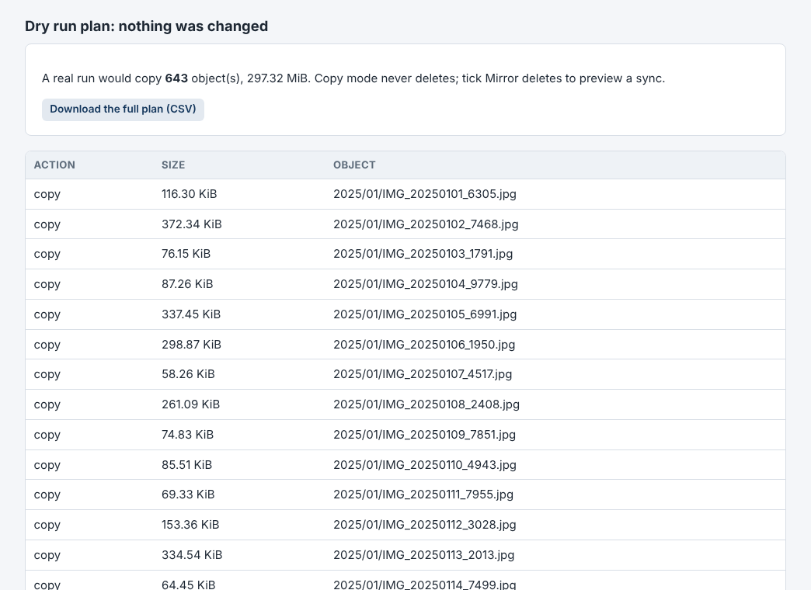

The plan comes from rclone's own dry run, so it shows exactly what a real run
would do. **Download the full plan (CSV)** gives the complete list for a
spreadsheet.

### 8.3 Advanced options


| Option | Use it to |
|---|---|
| Parallel transfers | Copy more objects at once (default 8 per worker). Raise it for many small objects. |
| Parallel checks | Compare more objects at once (default 16). |
| Workers | Run several rclone processes, each taking a share of the bucket's top-level prefixes (folders). Useful for very large buckets. Total parallel copies = workers × transfers. |
| Bandwidth limit | Limit network use, for example `50M` (50 MiB/s), or a timetable such as `08:00,10M 18:00,off` (slow during office hours, unlimited after). |
| Multipart part size, Parts uploaded in parallel | Tune how large objects are uploaded in parts. The defaults suit most cases. |
| Canned ACL for copied objects | Apply one access setting, such as `private`, to every copied object. |
| Target bucket already exists | Don't try to create the target bucket. Tick it when the target key may not create buckets. |
| Mirror deletes | Also **delete** target objects that aren't in the source. A real run needs the confirmation box ticked too. |
| Compress job logs and reports | Change when S3BucketFerry gzips its own log and report files (default: jobs above 10,000 objects). Bucket data is never compressed. |

### 8.4 First copy

Open **Migrate** again, fill in the same source and target, **untick Dry run**,
and select **Start migration**.

While it runs, the task page shows a live status panel. It refreshes every 3
seconds; you can close the browser and come back, because the task keeps
running on the server.


Section 10 explains every number. When the copy finishes, S3BucketFerry
compares source and target automatically. The job page then shows the result:


**Stop** on the task page ends a running task. Objects already copied stay on
the target; running the migration again continues where it stopped.

### 8.5 Incremental passes

While users keep working on the source, run **Migrate** again as often as you
like. Each pass compares every object by size and checksum and copies only
what is new or changed:

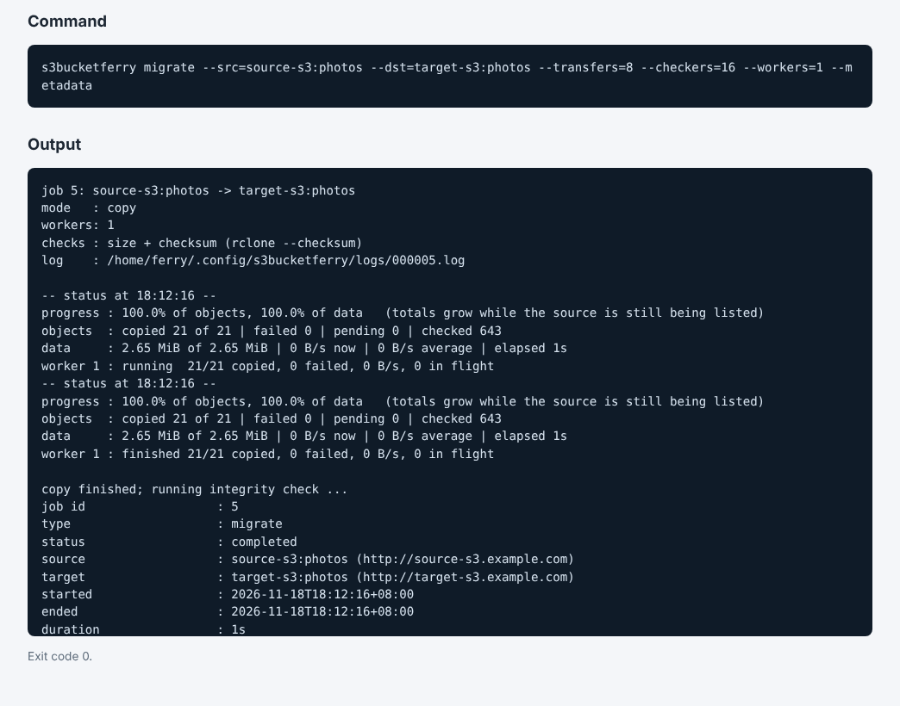

### 8.6 Verify (optional)

**Migration > Verify** compares both buckets object by object without copying
anything. It reports objects missing on the target, extra on the target, and
different. Here the target holds one object the source doesn't:

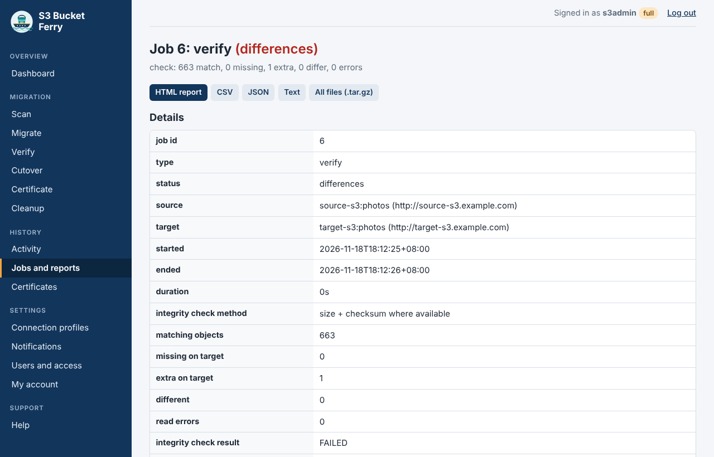


Tick **Full content check** to download and compare both copies byte by byte.
It is slow, but it also covers large objects uploaded in parts, which often
have no comparable checksum.

### 8.7 Preview the cutover

When you are ready to switch over, **stop all writes to the source bucket**.
Then open **Migration > Cutover**. **Dry run** is ticked by default.

Tick **Mirror deletes** under **Advanced options** if the target must end up an
exact copy, including removing objects that were deleted from the source
during the migration. For a dry run you don't need the confirmation box,
because nothing is deleted.


### 8.8 Cutover

Open **Cutover** again, **untick Dry run**, and, if you use Mirror deletes, tick
**I understand that mirror deletes removes objects from the target**:

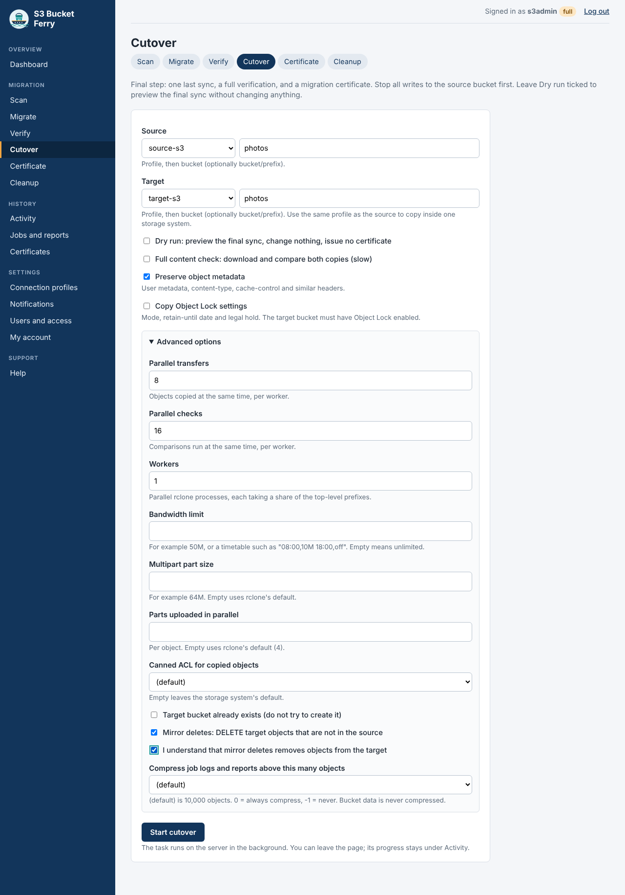

Cutover runs a final pass, then a full comparison of both buckets, and issues
the migration certificate:


### 8.9 The migration certificate

**History > Certificates** lists every certificate. Open the HTML file to read,
print or send it:

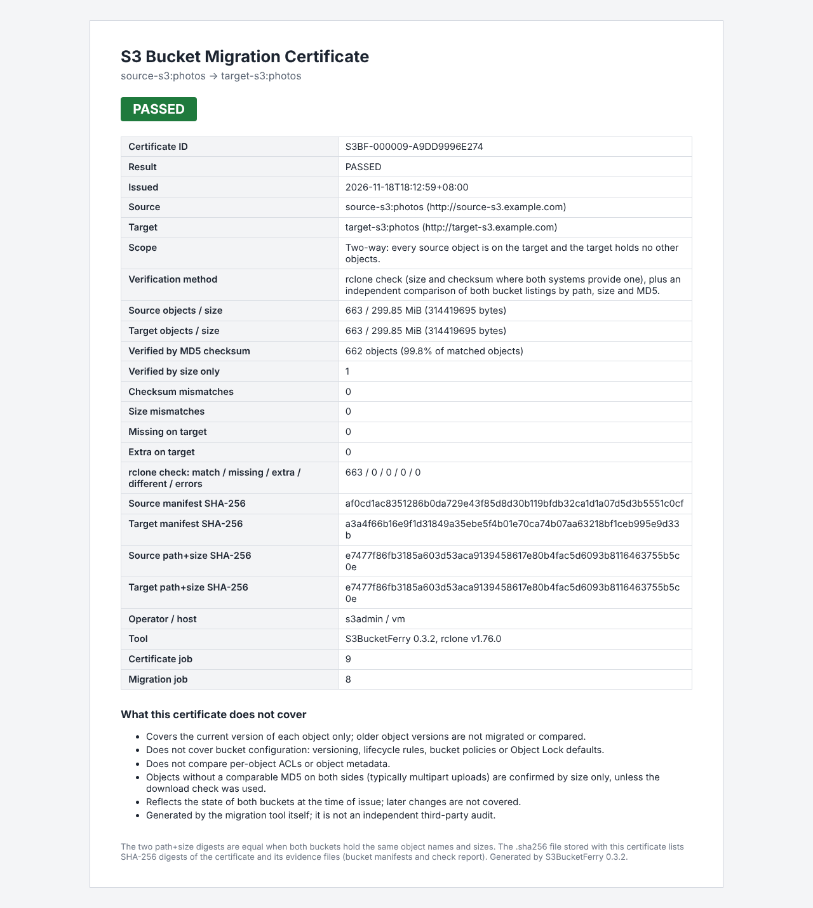

It records both buckets' object counts and sizes, how many objects were
verified by MD5 checksum and how many by size only, any problems, and SHA-256
digests of both bucket listings. Each certificate comes with a `.sha256` file:
`sha256sum -c` on it (Linux) proves the certificate and its evidence files
haven't been changed since. The certificate states what it doesn't cover, such
as older object versions and bucket settings.

### 8.10 Cleanup (optional)

Large objects are uploaded in parts. If an upload is interrupted, its parts can
stay on the bucket and use space without being visible as objects. **Cleanup**
lists these unfinished uploads. Untick **Only list** to remove those older than
the age you give (default 24 hours). Cleanup never touches complete objects.

## 9. Migrate with the command line

The command line does exactly what the web interface does, and its jobs appear
in the web interface too, as long as both use the same state folder. Run
`s3bucketferry <command> -h` for every option of a command.

### 9.1 Scan

```text
$ s3bucketferry scan --src source-s3:invoices
scanning source-s3:invoices ...
objects : 120
size    : 3.46 MiB (3630000 bytes)
job id  : 1
```

### 9.2 Dry run

```bash
s3bucketferry migrate --src source-s3:invoices --dst target-s3:invoices --dry-run
```

The run ends with the plan (the first 100 objects on screen, all of them in a
CSV file):

```text
DRY RUN PLAN - nothing was changed
  would copy   : 120 objects, 3.46 MiB (new or changed on the source)
  would delete : nothing (copy mode never deletes; add --mirror-deletes to preview a sync)

  ACTION  SIZE       OBJECT
  copy    20.02 KiB  2026/q1/INV-q1-0001.pdf
  copy    20.51 KiB  2026/q1/INV-q1-0002.pdf
  ...
full list: /home/ferry/.config/s3bucketferry/reports/000002-dry-run-plan.csv
```

### 9.3 First copy and incremental passes

```bash
s3bucketferry migrate --src source-s3:invoices --dst target-s3:invoices --metadata
```

```text
job 3: source-s3:invoices -> target-s3:invoices
mode   : copy
workers: 1
checks : size + checksum (rclone --checksum)
log    : /home/ferry/.config/s3bucketferry/logs/000003.log
...
objects copied          : 120
bytes copied            : 3.46 MiB (3630000 bytes)
failed objects          : 0
...
integrity check result  : PASSED
...
RESULT: copy complete and integrity check passed
```

`checks : size + checksum` confirms that rclone compares objects by size and
checksum (its `--checksum` mode, the default). After the copy, the integrity
check compares both sides again.

Run the same command again for each incremental pass. Common options:

| Option | Effect |
|---|---|
| `--dry-run` | List what would be copied (and deleted, with `--mirror-deletes`); change nothing |
| `--metadata` | Keep content type and custom metadata |
| `--workers N` | Parallel rclone processes, split by top-level prefix |
| `--transfers N` | Objects copied at once per worker (default 8) |
| `--bwlimit SPEC` | `50M`, or a timetable such as `"08:00,10M 18:00,off"` |
| `--chunk-size SIZE`, `--upload-concurrency N` | Multipart part size and parts in parallel |
| `--acl NAME` | Canned ACL for copied objects, such as `private` |
| `--no-check-bucket` | Don't try to create the target bucket |
| `--mirror-deletes` | Also delete target objects that aren't in the source (rclone sync) |
| `--no-verify` | Skip the comparison after the copy |
| `--compress-above N` | Gzip this job's logs and reports above N objects (default 10000; 0 = always, -1 = never) |

`--mirror-deletes` asks for no confirmation on the command line: typing it is
the confirmation. Try it with `--dry-run` first.

If a run is interrupted, `s3bucketferry resume <job id>` runs it again with the
same settings.

### 9.4 Verify

```text
$ s3bucketferry verify --src source-s3:invoices --dst target-s3:invoices
...
matching objects        : 121
missing on target       : 0
extra on target         : 0
different               : 0
integrity check result  : PASSED
RESULT: source and target match
```

`--download` compares full contents; `--one-way` ignores extra objects on the
target.

### 9.5 Cutover

Stop writes to the source, preview, then run:

```bash
s3bucketferry cutover --src source-s3:invoices --dst target-s3:invoices --metadata --dry-run
s3bucketferry cutover --src source-s3:invoices --dst target-s3:invoices --metadata --out-dir handover
```

```text
MIGRATION CERTIFICATE S3BF-000008-B47040BFD4A5: PASSED
files:
   /home/ferry/.config/s3bucketferry/certificates/000008-certificate.html
   ...
   handover/000008-certificate.html
   handover/000008-certificate.sha256
   handover/000008.source.manifest.tsv
   handover/000008.target.manifest.tsv
```

`--out-dir` copies the certificate and its evidence into a folder you can hand
over. Anyone can check it:

```text
$ cd handover && sha256sum -c *.sha256
000008-certificate.json: OK
000008-certificate.txt: OK
000008-certificate.html: OK
000008.source.manifest.tsv: OK
000008.target.manifest.tsv: OK
000008.check.txt: OK
```

`s3bucketferry certificate --src ... --dst ...` issues a certificate without
copying anything, for example for a migration done another way.

### 9.6 History and reports

```text
$ s3bucketferry jobs
ID  TYPE         STATUS     STARTED           DURATION  SOURCE              TARGET              RESULT
1   scan         completed  2026-11-18 18:17  0s        source-s3:invoices                      120 objects, 3.46 MiB
2   migrate      completed  2026-11-18 18:17  0s        source-s3:invoices  target-s3:invoices  dry run: would copy 120 objects, 3.46 MiB
3   migrate      completed  2026-11-18 18:17  1s        source-s3:invoices  target-s3:invoices  120 copied, 3.46 MiB, 0 failed; check: 120 match, ...
...
8   certificate  completed  2026-11-18 18:17  0s        source-s3:invoices  target-s3:invoices  ... certificate S3BF-000008-B47040BFD4A5 PASSED
```

| Command | Does |
|---|---|
| `job show <id>` | All details of one job |
| `report <id> --format html --out report.html` | A report as text, CSV, HTML or JSON |
| `job bundle <id> --out job.tar.gz` | Everything about a job (reports, logs, plan, failed list, certificate) in one archive |
| `cleanup --dst target-s3:invoices --list` | List unfinished multipart uploads (an empty list means none). Without `--list`, it **removes** those older than `--max-age` (default 24h). |

Exit codes: `0` success, `1` errors or differences, `2` usage error, `130`
interrupted.

## 10. Progress, failures and results

### The live status


| Item | Meaning |
|---|---|
| Objects % / Data % | How far the copy is, by number of objects and by amount of data. |
| Copied | Objects finished, out of the objects found so far. rclone lists the source while it copies, so the total can grow during a run. |
| Failed | Objects that couldn't be copied. |
| Pending | Objects queued or being copied right now. |
| Checked | Objects compared with the target (by size and checksum) and skipped because they already match. |
| Throughput | Speed now and on average. |
| Elapsed | Time so far, and an estimate of the time left. |
| Workers | One row per rclone process: its state, counts, speed, how many objects it has in flight, and which ones. |

On the command line the same information appears as a block that updates in
place:

```text
progress :  38.6% of objects,  28.0% of data   (totals grow while the source is still being listed)
objects  : copied 248 of 643 | failed 0 | pending 395 | checked 0
data     : 83.04 MiB of 296.89 MiB | 12.45 MiB/s now | 10.30 MiB/s average | elapsed 8s | ETA 17s
worker 1 : running  243/340 copied, 0 failed, 6.18 MiB/s, 8 in flight
worker 2 : running  5/303 copied, 0 failed, 6.27 MiB/s, 8 in flight
```

When the output goes to a file or the web interface, a block is printed every
10 seconds instead.

### Failed objects

If an object still fails after rclone's automatic retries, it is listed by
name with its last error. In this example the target storage went offline
during the copy:

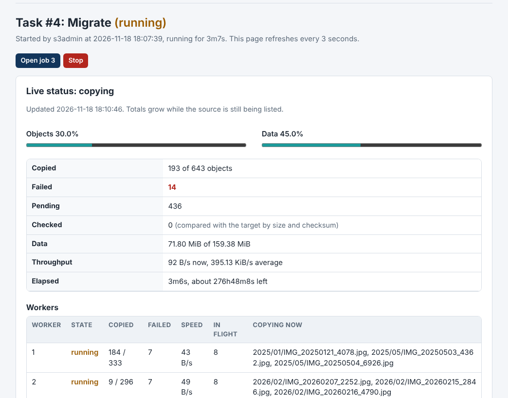


- The run prints the first 20; the job page lists up to 500.
- **Download the full list** gives `logs/<job>.failed-objects.tsv`: one line
  per object, with its error.
- An object that fails once but succeeds on a retry is not listed.
- To retry them, fix the cause (here: bring the target back), then run the
  same migration again or `resume` the job. Objects already copied are skipped.

### Job pages and downloads

Every job page has **HTML report**, **CSV**, **JSON**, **Text** and **All files
(.tar.gz)**. The archive holds the reports, logs, check report, dry-run plan,
failed-object list and certificate files, ready to attach to a ticket or keep
as a record.


### Large jobs

For jobs above 10,000 objects, S3BucketFerry stores its per-object files (rclone
logs, check reports, dry-run plans, failed-object lists and certificate
manifests) gzip-compressed, with a `.gz` ending. The web pages and reports read
them as usual. On Linux, read them with `zcat` or `zless`. Certificate evidence
is compressed before its checksums are recorded, so `sha256sum -c` still
works.

## 11. Users and access levels

**Settings > Users and access** (full access needed).


| Access | Can do |
|---|---|
| read-only | View the dashboard, activity, jobs, reports, certificates, connection profiles and help |
| read-write | Also start and stop tasks, and test profiles |
| full | Also manage profiles, notifications and users |

- **Add a user:** a name, an access level, and an initial password (leave it
  empty to generate one; it is shown once). The user must choose a new password
  at first login.
- **Change** a user's access with the list next to their name.
- **Reset password** generates a temporary password, shown once.
- **Disable** blocks a user and signs them out; **Enable** restores them.
- **Delete** removes a user.

At least one enabled user always keeps full access, and you can't disable or
delete your own account. Change your own password under **My account**.

If every administrator is locked out, on the server run:

```bash
s3bucketferry user list
s3bucketferry user reset-password --name s3admin   # prints a temporary password
s3bucketferry user unlock --name s3admin           # unlock without changing the password
```

## 12. Notifications

**Settings > Notifications** (full access) sends a message when a migration,
verification, cutover or certificate job ends: to a webhook (for example a chat
channel) and/or by e-mail. Like keys, the webhook URL and the SMTP password are
read from environment variables whose names you enter. **Send a test** checks
the settings.

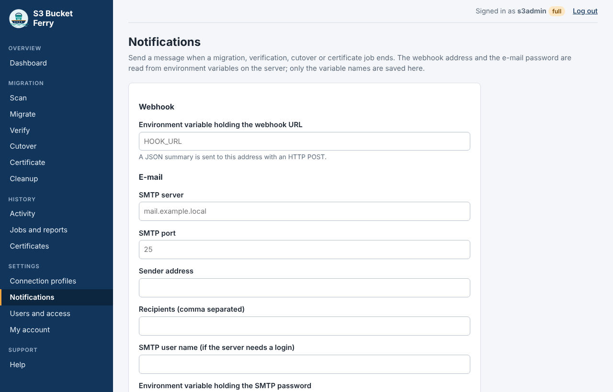

On the command line:

```bash
s3bucketferry notify set --webhook-url-env S3BF_WEBHOOK_URL
s3bucketferry notify set --smtp-host smtp.example.com --smtp-port 587 \
  --smtp-from ferry@example.com --smtp-to ops@example.com \
  --smtp-user ferry --smtp-pass-env S3BF_SMTP_PASSWORD
s3bucketferry notify test
```

## 13. Check for updates, upgrade and roll back

Upgrades and rollbacks are done on the command line of the S3BucketFerry
machine, not in the web interface. This keeps them in the hands of whoever
administers that machine.

On Linux and macOS, one command handles both S3BucketFerry and its rclone:
`s3bucketferry upgrade`. It runs `upgrade.sh`, which every release package
installs next to the program. It:

1. finds the newest S3BucketFerry release on GitHub and the newest rclone
   release;
2. downloads them and checks each against its published SHA-256 checksum. A
   mismatch stops it, with nothing changed;
3. refuses to start while a migration is running;
4. keeps a complete copy of the current install in `<install folder>.previous`
   (normally `/opt/s3bucketferry.previous`), for rollback;
5. replaces the program files;
6. restarts the `s3bucketferry-ui` service, if there is one, and checks it is
   running.

Your profiles, jobs, reports, certificates, web users and keys file are in
the state folder (section 14) and are never touched by an upgrade or a
rollback.

### 13.1 Check for a new version

```bash
s3bucketferry version                # the version installed
s3bucketferry upgrade --check        # installed and newest versions; changes nothing
```

```text
$ s3bucketferry upgrade --check
install folder: /opt/s3bucketferry
                installed    newest
S3BucketFerry   0.3.2        0.3.3        UPGRADE AVAILABLE
rclone          v1.76.0      v1.76.0      up to date
web UI service: s3bucketferry-ui (running)
```

| Status | Meaning |
|---|---|
| `up to date` | Nothing to do. |
| `UPGRADE AVAILABLE` | A newer version exists; continue with 13.3. |
| `could not reach GitHub` or `could not reach rclone.org or GitHub` | This machine has no internet access, or GitHub's limit of 60 checks an hour was reached. Try again later. |

`--check` needs no `sudo`. The newest S3BucketFerry versions, with what changed,
are also listed on the
[Releases page](https://github.com/debkhadanga2023-lgtm/S3BucketFerry/releases)
and in `CHANGELOG.md` in the install folder. rclone's newest version comes from
`downloads.rclone.org`.

### 13.2 Before you upgrade

- Let running migrations finish: check **Activity** in the web interface, or
  run `pgrep -a rclone`. The upgrade refuses to start while rclone from the
  install folder is running.
- Optional: back up the state folder, or take a snapshot if the machine is a
  virtual machine.

### 13.3 Upgrade

```bash
sudo s3bucketferry upgrade
```

`sudo` is needed because the install folder (`/opt/s3bucketferry`) belongs to
root. Without it, the command stops and shows the exact command to run.

The command asks before changing anything. Answer **Y**, or add `--yes` to skip
the question:

```text
$ sudo s3bucketferry upgrade
S3BucketFerry: 0.3.2 -> 0.3.3 (linux/amd64)
  install folder: /opt/s3bucketferry
Upgrade S3BucketFerry to 0.3.3? [Y/n] y
  downloading s3bucketferry-0.3.3-linux-amd64.tar.gz
  checksum OK: s3bucketferry-0.3.3-linux-amd64.tar.gz
  backup of the current install: /opt/s3bucketferry.previous
  installed: s3bucketferry 0.3.3, rclone v1.76.0
rclone v1.76.0 is up to date
  restarted the s3bucketferry-ui service
  s3bucketferry-ui is running

install folder: /opt/s3bucketferry
                installed    newest
S3BucketFerry   0.3.3        0.3.3        up to date
rclone          v1.76.0      v1.76.0      up to date
web UI service: s3bucketferry-ui (running)
```

If only rclone has a new version, the same command upgrades just rclone.

### 13.4 Check the result

```bash
s3bucketferry version                                  # the new version
s3bucketferry doctor                                   # versions, rclone found, profiles
sudo systemctl status s3bucketferry-ui --no-pager      # active (running)
```

Then log in to the web interface: your jobs, profiles and users are all there.
A dry run (section 8.2) is a quick way to confirm everything works.

### 13.5 Roll back

If the new version misbehaves, put back the install as it was before the last
upgrade, program and rclone together:

```bash
sudo s3bucketferry upgrade --rollback
```

```text
$ sudo s3bucketferry upgrade --rollback
current : s3bucketferry 0.3.3, rclone v1.76.0
previous: s3bucketferry 0.3.2, rclone v1.76.0
Go back to the previous install? [Y/n] y
  restored. The version you rolled back from is kept in /opt/s3bucketferry.previous (run --rollback again to return to it)
  restarted the s3bucketferry-ui service
  s3bucketferry-ui is running
```

- The two installs swap places, so running `--rollback` again returns to the
  newer version.
- Rollback needs a previous upgrade made with this command or `upgrade.sh`.
  Otherwise it stops with `no previous install to go back to`.
- Only one previous install is kept. To go back further, install a specific
  version: `sudo s3bucketferry upgrade --version 0.3.2`.
- Rollback only swaps program files. Jobs run with the newer version stay in
  the history.

### 13.6 Other upgrade options

| Command | Does |
|---|---|
| `sudo s3bucketferry upgrade --rclone-only` | Upgrade only rclone. Each release bundles the newest rclone when it is built; rclone may release again in between. |
| `sudo s3bucketferry upgrade --tool-only` | Upgrade only S3BucketFerry, with the rclone in its package. |
| `sudo s3bucketferry upgrade --version 0.3.2` | Install one specific version, newer or older. |
| `--yes` | Don't ask for confirmation. |
| `--force` | Upgrade even though a migration seems to be running. Use only if you are sure nothing is running. |
| `--dir FOLDER` | The install folder, if it isn't where `s3bucketferry` is found. |
| `--service NAME` | The service to restart, if it isn't `s3bucketferry-ui`. |

### 13.7 Upgrading from 0.3.1

Version 0.3.1 doesn't include the upgrade command yet. Download the script
once and run it; it works the same way:

```bash
cd /tmp
curl -fsSLO https://raw.githubusercontent.com/debkhadanga2023-lgtm/S3BucketFerry/main/scripts/upgrade.sh
bash upgrade.sh --check
sudo bash upgrade.sh
```

From then on use `s3bucketferry upgrade`. A rollback after this upgrade
(`sudo s3bucketferry upgrade --rollback`) returns to 0.3.1.

### 13.8 Builds from source

The upgrade command also works for a program you built yourself, as long as
`s3bucketferry` and `rclone` are in `/opt/s3bucketferry` (section 6). It replaces
them with the official release package. To stay on your own builds instead:

```bash
cd ~/S3BucketFerry && git pull
make build && bash scripts/fetch-rclone.sh linux amd64 .
sudo systemctl stop s3bucketferry-ui
sudo cp s3bucketferry rclone scripts/upgrade.sh /opt/s3bucketferry/
sudo systemctl start s3bucketferry-ui
```

### 13.9 Windows

Upgrades aren't automated on Windows, and there is no rollback command.

1. Check your version with `.\s3bucketferry.exe version`, and the newest on the
   [Releases page](https://github.com/debkhadanga2023-lgtm/S3BucketFerry/releases).
2. Stop the web interface (Ctrl+C in its window).
3. Copy the program folder (for example `C:\S3BucketFerry`) to
   `C:\S3BucketFerry.previous`. This copy is your rollback.
4. Download the new `windows-amd64.zip` and extract it over the program folder.
5. Start the web interface again.

To roll back, stop the web interface and copy the files from
`C:\S3BucketFerry.previous` back. Settings and history are in
`%AppData%\s3bucketferry` and are kept either way.

### 13.10 Upgrade problems

| Message | What to do |
|---|---|
| `no write access to /opt/s3bucketferry; run with sudo` | Run the command it shows, with `sudo`. |
| `a migration is running` | Wait for it to finish (`pgrep -a rclone`). Use `--force` only if you are sure nothing is running. |
| `could not find the newest release on GitHub` | No internet access, or GitHub's hourly limit was reached. Try later, or name the version with `--version`. |
| `checksum mismatch ... nothing was changed` | The download was damaged or altered. Try again later. If it repeats, report it on GitHub; don't install that file by hand. |
| `missing programs: unzip` | `sudo apt install -y unzip` (Ubuntu/Debian) or `sudo dnf install -y unzip` (Red Hat family). Needed for rclone downloads. |
| `no previous install to go back to` | No upgrade has been made with the command yet, so there is nothing to roll back to. Use `--version` to install a specific version. |
| `cannot find upgrade.sh next to s3bucketferry` | The install predates 0.3.2. Use 13.7 once. |
| The web interface doesn't start after an upgrade | `sudo journalctl -u s3bucketferry-ui -n 30`; if the new version is at fault, run `sudo s3bucketferry upgrade --rollback`. |

## 14. Where data is kept

Everything S3BucketFerry records is in its **state folder**:

| System | Default state folder |
|---|---|
| Linux | `~/.config/s3bucketferry` |
| Windows | `%AppData%\s3bucketferry` |
| macOS | `~/Library/Application Support/s3bucketferry` |

Set `S3BF_HOME` to use another folder. The web interface and the command line
share the history only when they use the same folder.

| File or folder | Content |
|---|---|
| `users.json` | Web accounts: names, access levels and salted password hashes (PBKDF2-SHA256), never plain passwords |
| `profiles.json`, `notify.json` | Settings, without keys or passwords |
| `jobs/` | One record per job, and the live status of running jobs |
| `logs/` | rclone logs and failed-object lists |
| `reports/` | Check reports, dry-run plans and bucket manifests |
| `certificates/` | Certificates (HTML, text, JSON) and their `.sha256` files |
| `ui-runs/`, `ui-runs.json` | Output of tasks started from the web interface |
| `audit.log` | One line per action: logins, failed logins, user and profile changes, tasks started, and every command run |

Back up this folder to keep the history and certificates. Restrict access to
it: it holds the password hashes and the job history.

## 15. What S3BucketFerry changes on your buckets

- **The source bucket is only ever read.** No command writes to it, changes it
  or deletes from it.
- **Scan, dry runs, verify and certificate change nothing** on either bucket.
- **Migrate and cutover** (copy mode, the default) write to the target only:
  - they add objects that aren't on the target yet;
  - they **overwrite** a target object with the same name as a source object
    but a different size or checksum, so the target matches the source;
  - they never delete anything;
  - they create the target bucket if it doesn't exist, unless you tick
    **Target bucket already exists** (`--no-check-bucket`);
  - the objects they write get the metadata, Object Lock and ACL settings you
    chose.
- **Mirror deletes** (`--mirror-deletes`) is the only mode that deletes objects:
  target objects that aren't in the source. Always preview it with a dry run.
- **Cleanup** removes unfinished multipart uploads, never complete objects.
- **Objects are copied byte for byte.** S3BucketFerry compresses only its own
  log and report files, never bucket data.
- With `--no-checksum` (change detection by size and time), rclone may update
  the modification-time metadata of target objects. The default checksum mode
  doesn't.

What isn't migrated: older object versions (only the current version of each
object), per-object ACLs (use a canned ACL instead), and bucket settings such as
versioning, lifecycle rules, bucket policies and Object Lock defaults.

## 16. Troubleshooting

| Problem | Likely cause | What to do |
|---|---|---|
| `environment variables X and Y must both be set` | The key variables aren't loaded in this session, or the profile holds the keys instead of variable names | Load the keys (section 4). If X looks like a key, remove the profile and add it again with variable names. |
| `InvalidAccessKeyId` or `SignatureDoesNotMatch` | Wrong key, or a space or quote pasted with it | Check the values in your keys file; restart the web interface after changes. |
| Error mentioning the region, or `AuthorizationHeaderMalformed` | The storage expects a specific region | Set the profile's region to the one your administrators gave you. |
| `AccessDenied` | The key lacks a permission | See the permissions in section 2. For bucket creation, create the target bucket first and tick **Target bucket already exists**. |
| `x509: certificate signed by unknown authority` | HTTPS certificate from a private certificate authority | Add the CA file to the profile (`--ca-cert`). |
| `NoSuchBucket` | Bucket name typo, or the endpoint expects bucket names in the host name | Check the name. Keep the provider on **Other**, which uses path-style addressing. |
| `RequestTimeTooSkewed` | This machine's clock is wrong | Fix the time: `timedatectl` (Linux), or **Settings > Time & language** (Windows). |
| Connection refused or timeouts | Wrong endpoint or port, firewall, or the storage is down | Test with `curl -I <endpoint>` from this machine. |
| Many failed objects | Network or storage trouble during the run | Fix the cause, then run the migration again: only missing objects are copied. |
| Certificate FAILED with checksum differences on large objects | The two systems compute checksums differently for objects uploaded in parts | Issue the certificate with **Full content check** (`--download`). |
| Web interface not reachable | It is listening on 127.0.0.1, the port is taken, or the firewall blocks it | Use `--listen 0.0.0.0:8080`; check `sudo ss -ltnp \| grep 8080` and the firewall (section 6). |
| Service fails at once (`status=1/FAILURE`) | Port in use, or part of `~/.config` belongs to root | `sudo journalctl -u s3bucketferry-ui -n 40`; see section 6 steps 1 and 2. |
| Locked out of the web interface | 5 wrong passwords | Wait 15 minutes, or `s3bucketferry user unlock --name <user>`. |

Logs: each job's rclone logs are in `logs/` in the state folder, and the web
interface service logs with `sudo journalctl -u s3bucketferry-ui`.

To report a problem, open an issue on
[GitHub](https://github.com/debkhadanga2023-lgtm/S3BucketFerry/issues) with the
job bundle (`s3bucketferry job bundle <id>`). Remove anything confidential
first, such as host names or bucket names you don't want to publish.

## 17. Glossary

| Word | Meaning |
|---|---|
| S3 | The storage protocol first used by Amazon S3, now supported by most object storage systems. |
| Object | A file stored in S3, with its data, size, checksum and metadata. |
| Bucket | A top-level container of objects, like a drive or share. |
| Prefix | The "folder" part of an object's name. In `2026/01/IMG_0001.jpg` the prefix is `2026/01/`. |
| Endpoint | The web address of an S3 storage system. |
| Access key, secret key | The user name and password S3 applications use. |
| Region | A location name some storage systems use for buckets, such as `us-east-1`. |
| Source, target | The storage you copy from, and the storage you copy to. |
| Connection profile | S3BucketFerry's saved settings for reaching one storage system. |
| Location | A profile plus a bucket and optional prefix, such as `source-s3:photos/2026`. |
| Dry run | A run that only reports what would change, and changes nothing. |
| Checksum (MD5) | A fingerprint of an object's contents; equal checksums mean equal contents. |
| Multipart upload | How large objects are uploaded: in parts that the storage joins together. |
| Incremental pass | A run that copies only new and changed objects. |
| Cutover | The final pass, after writes to the source stop, followed by verification and a certificate. |
| Mirror deletes (sync) | Also deleting target objects that aren't in the source, so the target is an exact copy. |
| Canned ACL | A predefined access setting for objects, such as `private`. |
| Object Lock | A storage feature that prevents objects from being changed or deleted until a set date. |
| Worker | One rclone process copying a share of the bucket. |
| Job | The record of one run: settings, results, reports and logs. |
| State folder | Where S3BucketFerry keeps its settings and history. |

---

S3BucketFerry is MIT licensed, Copyright (c) 2026 Deb Khadanga. It uses
[rclone](https://rclone.org), MIT licensed by its authors.
